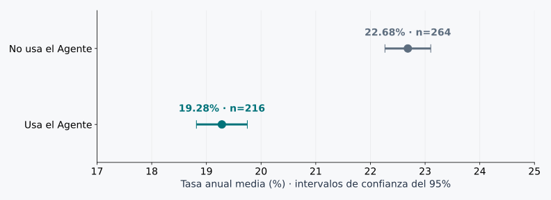
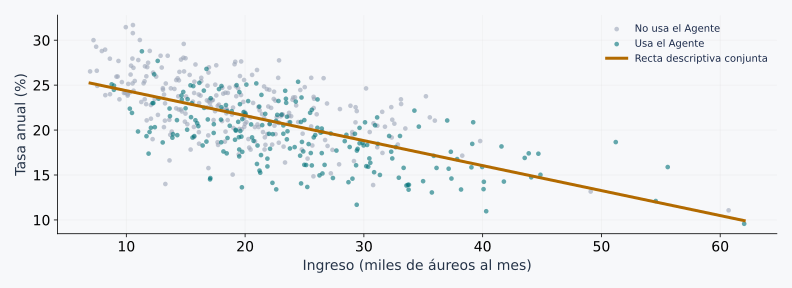

## De la muestra<br>a la inferencia {.portada}

```{ojs}
//| echo: false
//| output: false
import { liveBootstrap } from './assets/live-bootstrap.js'
```

::: {.kicker}
TALLER 1 · EVALUACIÓN DE IMPACTO · SESIÓN 01
:::

::: {.lead}
Una misión para la UARC:<br>
**leer evidencia antes de recomendar una política.**
:::

::: {.pill}
Marginalia, 2031 · 60 minutos · R + Python
:::

::: {.small .muted}
Primera versión para discusión. País, instituciones y datos ficticios.
:::

::: {.notes}
0–2 min. Presentar las tres capas del curso: intuición, formalización opcional y práctica. Hoy repasamos las herramientas que usaremos durante los siguientes talleres. Las cifras de la simulación son decisiones didácticas, no una calibración de un sistema financiero real.
:::

## Bienvenidos a Marginalia

::: {.two-up}
::: {.story-card}
**2029 · El Gran Apagón de PrecIA**

Siete bancos suben sus tasas al mismo tiempo tras una actualización del modelo de precios compartido.
:::
::: {.story-card}
**2031 · Nuestro encargo**

La Ley de Finanzas Algorítmicas exige evidencia causal. Somos la **UARC del Banco Central de Marginalia**.
:::
:::

::: {.takeaway}
El **Agente Ciudadano** cotiza, negocia y puede cambiar la deuda de banco. ¿Qué nos dicen los primeros datos de sus usuarios?
:::

::: {.notes}
2–4 min. Hechos tomados de caso.tex: 2030 aprobación de LFA, 2031 T1 piloto en dos regiones. No introducir resultados de los otros programas. El caso permanece como columna vertebral de los tres talleres.
:::

## La pregunta de hoy

::: {.lead}
“Quienes usan el Agente pagan tasas menores.<br>¿Tenemos evidencia suficiente para ampliarlo?”
:::

::: {.agenda}
- **0–12 min** · Del caso a una muestra y sus variables.
- **12–32 min** · Incertidumbre, hipótesis y medias.
- **32–48 min** · Proporciones, correlación y regresión.
- **48–60 min** · Memo con IA, verificación y cierre.
:::

::: {.notes}
4–5 min. Resultados esperados: identificar unidad y población; interpretar una diferencia con IC y p; distinguir proporción de media; interpretar correlación y pendiente; separar asociación de efecto causal. Los tiempos son guía, no cronómetro rígido.
:::

## Primera decisión {.checkpoint}

“La tasa media es menor entre usuarios del Agente”. ¿Qué podemos afirmar **solo con esa información**?

<div class="quiz">
<button type="button" data-correct="false" data-feedback="Necesitamos saber cómo se decidió el uso. Los usuarios pueden ser distintos desde antes.">El Agente causó la reducción de la tasa.</button>
<button type="button" data-correct="true" data-feedback="Sí: hay una asociación en los datos. Todavía faltan incertidumbre y un diseño que permita hablar de causalidad.">Hay una asociación; falta evaluar incertidumbre y selección.</button>
<button type="button" data-correct="false" data-feedback="Una muestra sí permite inferencia bajo supuestos. La cuestión es qué población y qué afirmación podemos sostener.">Con una muestra no podemos aprender nada.</button>
<p class="quiz-feedback" aria-live="polite"></p>
</div>

::: {.notes}
5–6 min. Votar antes de pulsar. Pedir dos explicaciones breves. Conservar la pregunta hasta el final.
:::

## De todo un país a una pregunta medible

| Elemento | Nuestra simulación didáctica |
|---|---|
| Población de referencia | 12,000 clientes elegibles con crédito activo en **Capital y Valle** |
| Muestra | 480 personas seleccionadas al azar, sin reemplazo |
| Unidad | Una persona, una observación al cierre del piloto |
| Comparación | Uso observado del Agente: **sí vs. no** |
| Resultados | Tasa anual (%) y cambio de banco (0/1) |

::: {.small}
Capital, Valle, el tamaño del marco y sus parámetros son **supuestos de esta simulación**. El caso plantea un piloto aleatorizado; aquí observamos **uso**, no asignación ni invitación. No extrapolamos a los 41 millones de habitantes.
:::

::: {.notes}
6–8 min. La muestra es aleatoria respecto al marco; el uso del Agente no es aleatorio. Muestreo y asignación son dos mecanismos diferentes. No estimamos ITT en esta sesión. Marco didáctico pequeño y sin dependencia entre personas para mantener el repaso sencillo.
:::

## Un archivo, dos lenguajes

::: {.two-up}
::: {}
**Variables que sí observamos**

`id_persona`, `region`, `edad`, `ingreso_miles`, `usa_agente`, `tasa_anual`, `cambio_banco`.

::: {.small}
Ingreso: miles de áureos al mes.<br>
Tasa: 18 significa 18% anual.<br>
Cambio: 1 = cambió de banco durante el piloto.
:::
:::
::: {.story-card}
**Cómo usar los laboratorios**

1. Elige la pestaña **R** o **Python**.
2. Pulsa **Run Code** o `Ctrl/Cmd + Enter`.
3. Edita y vuelve a ejecutar.

::: {.small}
**Start Over** restaura el código de esa celda. Cada laboratorio vuelve a leer el mismo CSV.
:::
:::
:::

::: {.small .muted}
Abre las slides mediante Quarto Preview o un servidor HTTP. La primera carga de R/Python necesita internet y puede tardar; espera a que se habilite Run Code. Navega con flechas; `Esc` abre la vista general y `S` las notas.
:::

::: {.notes}
8–9 min. Dejar precargar ambos entornos desde el inicio. Si la red institucional bloquea CDNs, usar los scripts locales exportados y las figuras de respaldo. Los cálculos deterministas deben coincidir; las simulaciones R/Python no usan el mismo generador aleatorio.
:::

## Laboratorio 1 · Conocer la muestra {.lab}

::: {.prompt}
Antes de inferir: ¿cuántas observaciones hay y en qué unidades está el resultado?
:::

::: {.panel-tabset group="lenguaje"}
### R

```{webr}
#| exercise: explorar-r
d <- read.csv("datos/muestra.csv")
head(d, 4)
cat("Personas:", nrow(d), "\n")
table(d$region, d$usa_agente)
aggregate(cbind(tasa_anual, cambio_banco) ~ usa_agente,
          data = d, FUN = mean)
```

### Python

```{pyodide}
#| exercise: explorar-py
import pandas as pd
d = pd.read_csv("datos/muestra.csv")
print(d.head(4).to_string(index=False))
print("Personas:", len(d))
print(pd.crosstab(d.region, d.usa_agente))
print(d.groupby("usa_agente")[["tasa_anual", "cambio_banco"]].mean())
```
:::

::: {.notes}
9–12 min. Dar 90 segundos para ejecutar. Mostrar que media de una variable 0/1 = proporción. No interpretar todavía la comparación como causal. El mismo archivo evita confundir diferencias de implementación con diferencias de datos.
:::

## Una muestra no es la población

::: {.two-up}
::: {.story-card}
**Parámetro**

$\mu$: media de la tasa en las 12,000 personas del marco.

Es fija para esta población; normalmente no la conocemos.
:::
::: {.story-card}
**Estimador**

$\bar Y=\frac{1}{n}\sum_i Y_i$: media en nuestra muestra.

Cambia al extraer otra muestra.
:::
:::

::: {.takeaway}
Inferir es pasar de una estimación a una afirmación sobre la población, **con incertidumbre y supuestos explícitos**.
:::

::: {.notes}
12–14 min. La población completa existe solo porque la generamos. En el trabajo real no tenemos esa ventaja. En el siguiente ejercicio nos ponemos el sombrero de simulador, no de analista omnisciente.
:::

## Laboratorio 2 · Repetir el muestreo {.lab}

::: {.prompt}
Cambia `n = 40` a `n = 200`. ¿Qué ocurre con la dispersión de 300 medias muestrales?
:::

::: {.panel-tabset group="lenguaje"}
### R

```{webr}
#| exercise: muestreo-r
pob <- read.csv("datos/poblacion_tasas.csv")$tasa_anual
set.seed(42)
n <- 40  # prueba 200; debe ser menor que length(pob)
medias <- replicate(300, mean(sample(pob, n, replace = FALSE)))
cat("DE de medias:", round(sd(medias), 3), "pp\n")
par(mar = c(4, 4, 1, 1))
hist(medias, breaks = 20, col = "#007279", border = "white",
     xlim = c(18, 24), main = "", xlab = "Media de tasa anual (%)")
abline(v = mean(pob), col = "#B26A00", lwd = 3)
```

### Python

```{pyodide}
#| exercise: muestreo-py
import numpy as np
import pandas as pd
import matplotlib.pyplot as plt
pob = pd.read_csv("datos/poblacion_tasas.csv").tasa_anual.to_numpy()
rng = np.random.default_rng(42)
n = 40  # prueba 200; debe ser menor que len(pob)
medias = [rng.choice(pob, n, replace=False).mean() for _ in range(300)]
print(f"DE de medias: {np.std(medias, ddof=1):.3f} pp")
fig, ax = plt.subplots(figsize=(9, 3.2))
ax.hist(medias, bins=20, color="#007279", edgecolor="white")
ax.axvline(pob.mean(), color="#B26A00", linewidth=3)
ax.set(xlim=(18, 24), xlabel="Media de tasa anual (%)", ylabel="Frecuencia")
fig.tight_layout()
plt.show()
```
:::

::: {.small}
La línea ámbar es la media del marco sintético. Misma población; las realizaciones aleatorias pueden diferir entre R y Python.
:::

::: {.notes}
14–18 min. Fijamos los ejes para comparar dispersión visual entre n=40 y n=200. Al aumentar n cinco veces, la dispersión cae aproximadamente por sqrt(5), con pequeña corrección de población finita. La semilla fija reproduce cada lenguaje, no genera las mismas muestras entre lenguajes.
:::

## Del ruido a un intervalo

::: {.equation}
$$SE(\bar Y)\approx \frac{s}{\sqrt{n}},\qquad
IC_{95\%}(\mu)=\bar Y\pm t_{0.975,n-1}\,SE(\bar Y).$$
:::

::: {.two-up}
::: {}
**Desviación estándar** ($s$)

Dispersión de las tasas entre personas.
:::
::: {}
**Error estándar** ($SE$)

Dispersión de las medias entre muestras.
:::
:::

::: {.takeaway}
Si repitiéramos el procedimiento, aproximadamente 95% de los intervalos cubrirían el parámetro. El 95% describe el **procedimiento**, no una probabilidad asignada al parámetro fijo.
:::

::: {.small .muted}
Usamos observaciones independientes y aproximaciones de muestras grandes. Omitimos la pequeña corrección por población finita (480/12,000 = 4%). La dependencia y el clustering llegan en la sesión 12.
:::

::: {.notes}
18–20 min. No derivar t. Si preguntan por normalidad, distinguir validez exacta bajo normalidad de aproximación asintótica. La corrección finita para la media del marco es sqrt((N-n)/(N-1)) ~0.98; no cambia la lección.
:::

## Primera evidencia · Tasas observadas

{width=88%}

::: {.takeaway}
La comparación relevante es **usuarios menos no usuarios**, en puntos porcentuales. Falta cuantificar la incertidumbre de esa diferencia.
:::

::: {.notes}
20–21 min. Gráfica precalculada en Python con el CSV observado; el script R genera el equivalente. Los intervalos de cada media no son un test de la diferencia: usar Welch en la siguiente práctica.
:::

## Una prueba empieza con una pregunta

::: {.two-up}
::: {.story-card}
**Hipótesis nula**

$H_0:\mu_1-\mu_0=0$

Igualdad de tasas medias entre grupos de uso en el marco de referencia.
:::
::: {.story-card}
**Hipótesis alternativa**

$H_1:\mu_1-\mu_0\neq0$

Prueba bilateral; fijamos $\alpha=0.05$ antes de mirar el resultado.
:::
:::

El **valor p** mide qué tan extremos serían los datos —o más— bajo $H_0$ y los supuestos de la prueba.

::: {.small}
No es $P(H_0\mid\text{datos})$. Rechazar igualdad tampoco identifica un efecto causal.
:::

::: {.notes}
21–23 min. Esta es inferencia sobre grupos de uso, no una prueba de impacto. No introducimos ATE ni ATT formalmente. Pruebas bilaterales y niveles definidos antes de ver la muestra. Comparar con un umbral de relevancia práctica también definido de antemano.
:::

## Laboratorio 3 · Comparar medias {.lab}

::: {.prompt}
Estima $\widehat\Delta=\bar Y_1-\bar Y_0$. Usa **Welch**: no exige varianzas iguales.
:::

::: {.panel-tabset group="lenguaje"}
### R

```{webr}
#| exercise: medias-r
d <- read.csv("datos/muestra.csv")
y1 <- d$tasa_anual[d$usa_agente == 1]
y0 <- d$tasa_anual[d$usa_agente == 0]
prueba <- t.test(y1, y0, alternative = "two.sided", var.equal = FALSE)
cat("Diferencia (pp):", mean(y1) - mean(y0), "\n")
cat("IC 95%:", prueba$conf.int, "\n")
cat("p bilateral:", format(prueba$p.value, scientific = TRUE, digits = 4), "\n")
```

### Python

```{pyodide}
#| exercise: medias-py
import pandas as pd
from scipy import stats
d = pd.read_csv("datos/muestra.csv")
y1 = d.loc[d.usa_agente == 1, "tasa_anual"]
y0 = d.loc[d.usa_agente == 0, "tasa_anual"]
prueba = stats.ttest_ind(y1, y0, equal_var=False, alternative="two-sided")
ic = prueba.confidence_interval(confidence_level=0.95)
print(f"Diferencia (pp): {y1.mean() - y0.mean():.4f}")
print(f"IC 95%: [{ic.low:.4f}, {ic.high:.4f}]")
print(f"p bilateral: {prueba.pvalue:.4g}")
```
:::

::: {.notes}
23–28 min. Ejecutar en uno de los lenguajes; después contrastar con el otro. Revisar orden usuarios-no usuarios y significado del signo. No usar prueba pareada: las personas de los grupos son distintas. No necesitamos probar antes igualdad de varianzas para elegir Welch.
:::

## Tres preguntas para leer el resultado

::: {.metric-grid}
::: {.metric}
::: {.label}
1 · DIFERENCIA
:::
::: {.value}
−3.40 pp
:::
Usuarios menos no usuarios: la tasa media es menor entre usuarios.
:::
::: {.metric}
::: {.label}
2 · INTERVALO DEL 95%
:::
::: {.value}
[−4.03, −2.78]
:::
IC del 95% de la diferencia, en puntos porcentuales.
:::
::: {.metric}
::: {.label}
3 · PRUEBA BILATERAL
:::
::: {.value}
$p<0.001$
:::
Rechazamos igualdad de medias bajo los supuestos. No identifica impacto causal.
:::
:::

::: {.takeaway}
Reporta **estimación + unidades + intervalo + alcance**. El umbral 0.05 no reemplaza ese razonamiento.
:::

::: {.notes}
28–30 min. Medias: usuarios 19.283%, no usuarios 22.684%; n=216 y 264. Diferencia -3.4012 pp; IC95 [-4.0257,-2.7766]; p=5.2058e-24. Pedir a alguien leer sus números en voz alta y reservar la afirmación causal. El resumen docente completo no forma parte de la web.
:::

## Un p pequeño, una conclusión precisa {.checkpoint}

¿Qué conclusión es válida si la prueba de Welch arroja $p<0.05$?

<div class="quiz">
<button type="button" data-correct="false" data-feedback="El valor p no es la probabilidad de que H0 sea cierta. Es una probabilidad de resultados bajo H0 y los supuestos.">La probabilidad de que no haya diferencia es menor a 5%.</button>
<button type="button" data-correct="true" data-feedback="Rechazamos igualdad de medias al 5% bajo los supuestos de la prueba. La causalidad exige algo más.">Los datos son poco compatibles con igualdad de medias, bajo los supuestos.</button>
<button type="button" data-correct="false" data-feedback="Precisión estadística no elimina selección: quienes usan el Agente pueden tener mayor sofisticación financiera.">Ya sabemos cuánto reduce las tasas el Agente.</button>
<p class="quiz-feedback" aria-live="polite"></p>
</div>

::: {.notes}
30–32 min. También aclarar no rechazar no demuestra igualdad. Un intervalo muy ancho puede ser compatible tanto con cero como con diferencias grandes.
:::

## Segundo resultado · Cambiar de banco

`cambio_banco` vale 1 si la persona cambió de banco durante el piloto y 0 si no.

::: {.equation}
$$\hat p_g=\frac{\text{personas que cambiaron en el grupo }g}{n_g},
\qquad \widehat\Delta_p=\hat p_1-\hat p_0.$$
:::

::: {.two-up}
::: {.story-card}
**La media de 0/1 es una proporción**

0.25 se comunica como 25%.
:::
::: {.story-card}
**La diferencia necesita su escala**

30% − 20% = **10 pp**; el aumento relativo es 50%.
:::
:::

::: {.notes}
32–34 min. Las cifras 30% y 20% son ejemplo de unidades, no resultados de nuestro CSV. Proporción no significa conteo ni probabilidad causal. El denominador es cada grupo de uso.
:::

## Laboratorio 4 · Comparar proporciones {.lab}

::: {.prompt}
Prueba bilateral $H_0:p_1=p_0$. IC normal **no agrupado** y test z con proporción **agrupada** bajo $H_0$.
:::

::: {.panel-tabset group="lenguaje"}
### R

```{webr}
#| exercise: proporciones-r
d <- read.csv("datos/muestra.csv")
a <- d$cambio_banco[d$usa_agente == 1]
b <- d$cambio_banco[d$usa_agente == 0]
p1 <- mean(a); p0 <- mean(b); n1 <- length(a); n0 <- length(b)
dif <- p1 - p0
se <- sqrt(p1 * (1-p1)/n1 + p0 * (1-p0)/n0)
ic <- dif + c(-1, 1) * qnorm(.975) * se
pool <- (sum(a) + sum(b)) / (n1 + n0)
z <- dif / sqrt(pool * (1-pool) * (1/n1 + 1/n0))
cat("Proporciones (uso 1, 0):", p1, p0, "\n")
cat("Diferencia e IC (pp):", 100 * c(dif, ic), "\n")
cat("p bilateral:", 2 * pnorm(-abs(z)), "\n")
```

### Python

```{pyodide}
#| exercise: proporciones-py
import numpy as np
import pandas as pd
from scipy import stats
d = pd.read_csv("datos/muestra.csv")
a = d.loc[d.usa_agente == 1, "cambio_banco"]
b = d.loc[d.usa_agente == 0, "cambio_banco"]
p1, p0, n1, n0 = a.mean(), b.mean(), len(a), len(b)
dif = p1 - p0
se = np.sqrt(p1*(1-p1)/n1 + p0*(1-p0)/n0)
ic = dif + np.array([-1, 1]) * stats.norm.ppf(.975) * se
pool = (a.sum() + b.sum()) / (n1 + n0)
z = dif / np.sqrt(pool*(1-pool)*(1/n1 + 1/n0))
print(f"Proporciones (uso 1, 0): {p1:.4f}, {p0:.4f}")
print(f"Diferencia: {100*dif:.2f} pp; IC: {100*ic}")
print(f"p bilateral: {2*stats.norm.sf(abs(z)):.4g}")
```
:::

::: {.small}
Referencia: **27.8% vs. 8.7%**, diferencia **19.1 pp**, IC95 **[12.2, 25.9] pp**. La aproximación normal requiere suficientes éxitos y fracasos; al filtrar, vuelve a comprobarlo.
:::

::: {.notes}
34–39 min. Usuarios 60/216; no usuarios 23/264. p=3.9073e-8, sin corrección de continuidad. El intervalo Wald puede tener mal comportamiento con muestras pequeñas o proporciones extremas. Aquí se elige por transparencia y equivalencia entre lenguajes. Verificar al menos 10 éxitos y 10 fracasos por grupo; si cambian filtros deben revisar esta condición. No llamar exacta a esta prueba.
:::

## ¿Qué relación tiene el ingreso con la tasa?

{width=88%}

::: {.small}
Cada punto es una persona. La recta resume la asociación en toda la muestra; los colores distinguen uso observado.
:::

::: {.notes}
39–40 min. Preguntar dirección, fuerza y posibles observaciones extremas. No decir que dar más ingreso al cliente reduce automáticamente su tasa. Figura de respaldo generada localmente, visible aunque los runtimes no hayan cargado.
:::

## Laboratorio 5 · Ver y medir asociación {.lab}

::: {.prompt}
Calcula $r\in[-1,1]$ y mira la nube: **Pearson resume asociación lineal**, es sensible a valores extremos.
:::

::: {.panel-tabset group="lenguaje"}
### R

```{webr}
#| exercise: correlacion-r
d <- read.csv("datos/muestra.csv")
cat("r de Pearson:", cor(d$ingreso_miles, d$tasa_anual), "\n")
par(mar = c(4, 4, 1, 1))
plot(d$ingreso_miles, d$tasa_anual, pch = 16,
     col = adjustcolor(c("#9BA5B7", "#007279")[d$usa_agente + 1], .6),
     xlab = "Ingreso (miles de áureos / mes)", ylab = "Tasa anual (%)")
abline(lm(tasa_anual ~ ingreso_miles, data = d), col = "#B26A00", lwd = 3)
```

### Python

```{pyodide}
#| exercise: correlacion-py
import pandas as pd
import numpy as np
import matplotlib.pyplot as plt
d = pd.read_csv("datos/muestra.csv")
print("r de Pearson:", d.ingreso_miles.corr(d.tasa_anual))
b1, b0 = np.polyfit(d.ingreso_miles, d.tasa_anual, 1)
fig, ax = plt.subplots(figsize=(9, 3.2))
colores = np.where(d.usa_agente == 1, "#007279", "#9BA5B7")
ax.scatter(d.ingreso_miles, d.tasa_anual, c=colores, alpha=.6, s=14)
x = np.array([d.ingreso_miles.min(), d.ingreso_miles.max()])
ax.plot(x, b0 + b1*x, color="#B26A00", linewidth=3)
ax.set(xlabel="Ingreso (miles de áureos / mes)", ylabel="Tasa anual (%)")
fig.tight_layout()
plt.show()
```
:::

::: {.notes}
40–43 min. Correlación es adimensional y simétrica; regresión tiene dirección y unidades. r=0 no descarta relaciones no lineales. Un outlier puede mover r; dejar como ejercicio opcional inspeccionar el gráfico antes de calcular.
:::

## Una recta transforma la relación en unidades

::: {.equation}
$$Y_i=\beta_0+\beta_1X_i+\varepsilon_i,
\qquad \widehat Y_i=\hat\beta_0+\hat\beta_1X_i.$$
:::

::: {.two-up}
::: {.story-card}
**$X$ · Ingreso mensual**

Un incremento de una unidad son **1,000 áureos al mes**.
:::
::: {.story-card}
**$Y$ · Tasa anual (%)**

$\hat\beta_1$ se expresa en **pp por cada 1,000 áureos** adicionales de ingreso.
:::
:::

::: {.takeaway}
La recta describe la muestra. “Se asocia con” es una lectura válida; “causa” requiere un diseño y supuestos adicionales.
:::

::: {.notes}
43–44 min. El intercepto evalúa X=0, que no es una observación típica; evitar darle interpretación económica fuera del soporte. Relación de beta1 con r: r*sY/sX. El siguiente ejercicio usa error estándar OLS convencional, sin afirmar que identifica causalidad.
:::

## Laboratorio 6 · Estimar e interpretar la pendiente {.lab}

::: {.panel-tabset group="lenguaje"}
### R

```{webr}
#| exercise: regresion-r
d <- read.csv("datos/muestra.csv")
modelo <- lm(tasa_anual ~ ingreso_miles, data = d)
cat("Intercepto y pendiente:\n")
print(coef(modelo))
cat("IC 95% de la pendiente:", confint(modelo)["ingreso_miles", ], "\n")
cat("p bilateral:", coef(summary(modelo))["ingreso_miles", "Pr(>|t|)"], "\n")
cat("R cuadrada:", summary(modelo)$r.squared, "\n")
```

### Python

```{pyodide}
#| exercise: regresion-py
import pandas as pd
import numpy as np
from scipy import stats
d = pd.read_csv("datos/muestra.csv")
modelo = stats.linregress(d.ingreso_miles, d.tasa_anual)
ic = modelo.slope + np.array([-1, 1]) * stats.t.ppf(.975, len(d)-2) * modelo.stderr
print(f"Intercepto: {modelo.intercept:.4f}; pendiente: {modelo.slope:.4f}")
print(f"IC 95% de la pendiente: {ic}")
print(f"p bilateral: {modelo.pvalue:.4g}")
print(f"R cuadrada: {modelo.rvalue**2:.4f}")
```
:::

::: {.prompt}
Completa: “En esta muestra, 1,000 áureos más de ingreso mensual se asocian con ___ pp de tasa anual”.
:::

::: {.small .muted}
IC y p usan inferencia OLS convencional, con aproximación de errores homocedásticos. Veremos errores robustos y dependencia en la sesión 12. $R^2$ describe ajuste; no valida causalidad.
:::

::: {.notes}
44–48 min. SciPy linregress y lm coinciden para regresión simple con intercepto y sin valores faltantes. El mecanismo simulado es no lineal en ingreso y selección; tratamos la recta como resumen descriptivo y la inferencia convencional como punto de partida del repaso.

Referencia: r=-0.6272; intercepto 27.1627, pendiente -0.2780 pp por 1000 áureos, IC95 [-0.3091,-0.2470], R2=.3933. La correlación no es el porcentaje explicado, y la pendiente no es una elasticidad.
:::

## Más precisión no elimina la selección

::: {.two-up}
::: {.story-card}
**Incertidumbre de muestreo**

¿Cambiaría mucho la estimación con otra muestra?

La atendemos con errores estándar, intervalos y pruebas.
:::
::: {.story-card}
**Validez causal**

¿Los grupos ya diferían antes de usar el Agente?

La sofisticación financiera puede favorecer tanto el uso como mejores condiciones de crédito.
:::
:::

::: {.takeaway}
**Diferencia observada = efecto sobre usuarios + sesgo de selección.**<br>
Hoy medimos diferencias. En las siguientes sesiones construiremos el contrafactual.
:::

::: {.notes}
48–50 min. La descomposición exacta corresponde a diferencia de medias condicionales y ATT más sesgo; formalizar en sesión 3. No revelar el efecto conocido del simulador ni cargar potenciales al navegador. Una asignación aleatoria no implica uso aleatorio si hay cumplimiento imperfecto; recuperar invitación/asignación será clave después.
:::

## Tu encargo · Un memo de cuatro frases

::: {.prompt}
La UARC debe contestar qué aprendió y qué falta. Trabajen en parejas durante **6 minutos**.
:::

1. **Medias:** diferencia de tasas, IC del 95%, valor p y unidades.
2. **Proporciones:** diferencia de cambio de banco, IC y denominadores.
3. **Asociación:** correlación o pendiente del ingreso, con interpretación.
4. **Alcance:** una conclusión que sostienes y una limitación para evaluar impacto.

::: {.takeaway}
Tu memo debe permitir que otra persona **reproduzca los números** y sepa a qué población se refieren.
:::

::: {.notes}
50–51 min. Explicar encargo y pasar al prompt. En 6 minutos basta ejecutar un lenguaje; una persona verifica unidades y la otra interpretación. Comparar código en el otro lenguaje si avanzan rápido.
:::

## IA como apoyo · Tú verificas el resultado

::: {.prompt .small}
Usa `datos/muestra.csv`, un archivo de datos sintéticos de Marginalia. Cada fila es una persona; compara `usa_agente=1` menos `usa_agente=0`. `tasa_anual` está en porcentaje y `cambio_banco` es 0/1.

Genera código en **[R o Python]** para una diferencia de tasas con Welch e IC del 95%, una diferencia de proporciones con IC normal no agrupado y prueba z agrupada, y una regresión simple de tasa sobre `ingreso_miles`. No inventes resultados: pide ejecutar el código si no tienes acceso al CSV.

Ayúdame a redactar un memo de cuatro frases con magnitud, unidades e incertidumbre. Señala por qué comparar uso observado no demuestra impacto causal. No agregues variables que no estén en el archivo.
:::

::: {.small}
**Verifica:** signo 1−0 · pp vs. % · mismo número de filas · equivalencia R/Python · afirmaciones que el diseño permite. Si la IA propone otra prueba, justifica el cambio antes de aceptar sus cifras.
:::

::: {.notes}
51–57 min. Enviar solo datos sintéticos. Si no hay IA disponible, usar los laboratorios como referencia y redactar memo manual. La tarea no depende de contratar un servicio. El docente tiene una guía y cifras de referencia fuera de los recursos del alumno.
:::

## Antes de salir {.checkpoint}

Duplicamos la muestra, mantenemos el mismo mecanismo de adopción y obtenemos un IC más estrecho. ¿Qué cambia?

<div class="quiz">
<button type="button" data-correct="true" data-feedback="Sí. Más observaciones suelen mejorar precisión; no hacen comparables por sí solas a usuarios y no usuarios.">Mejora la precisión; la selección puede seguir presente.</button>
<button type="button" data-correct="false" data-feedback="El tamaño muestral no sustituye una asignación aleatoria ni elimina diferencias previas entre grupos.">La asociación se convierte en un efecto causal.</button>
<button type="button" data-correct="false" data-feedback="La dispersión entre personas no tiene por qué caer. Lo que suele caer con n es la dispersión del estimador.">La desviación de las tasas entre personas cae a la mitad.</button>
<p class="quiz-feedback" aria-live="polite"></p>
</div>

::: {.takeaway}
Sesión 2: de la pregunta de política al estimando.<br>¿Qué efecto queremos conocer y para quién?
:::

::: {.notes}
57–60 min. Escuchar un memo y resolver el quiz. Pedir como salida una frase de evidencia y una de limitación. Reforzar: mayor n mejora precisión aproximadamente a tasa sqrt(n), no garantiza validez causal ni representatividad nacional.
:::

## Para continuar

::: {.two-up .small}
::: {}
**Material de esta sesión**

- [Muestra sintética · CSV](datos/muestra.csv)
- [Código completo · R](codigo/sesion-1.R)
- [Código completo · Python](codigo/sesion-1.py)
- Fuentes del caso: `documents_overleaf/caso.tex` y `temario.tex`, sesión 1.
:::
::: {}
**Referencias técnicas**

- [Quarto · Presentaciones reveal.js](https://quarto.org/docs/presentations/revealjs/)
- [Quarto Live · Código en las slides](https://r-wasm.github.io/quarto-live/other/slides.html)
- [R · Prueba t](https://stat.ethz.ch/R-manual/R-devel/library/stats/html/t.test.html)
- [SciPy · Welch](https://docs.scipy.org/doc/scipy/reference/generated/scipy.stats.ttest_ind.html)
- [SciPy · Regresión simple](https://docs.scipy.org/doc/scipy/reference/generated/scipy.stats.linregress.html)
:::
:::

::: {.small .muted}
Todas las cifras son sintéticas. Las regiones elegidas, los tamaños y los parámetros de esta sesión son supuestos didácticos; no son resultados reales del caso ni de una institución.
:::

::: {.notes}
Después de clase. Descargar los CSV y scripts desde servidor HTTP. Los scripts parten del directorio de la sesión. La guía docente explica cómo regenerar datos y figuras. El archivo docente nunca se publica como recurso de esta presentación.
:::
