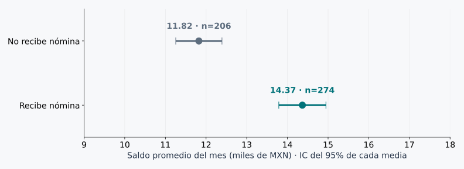

## De la muestra<br>a la inferencia {.portada}

```{ojs}
//| echo: false
//| output: false
import { liveBootstrap } from './assets/live-bootstrap.js'
```

::: {.kicker}
TALLER 1 · EVALUACIÓN DE IMPACTO · SESIÓN 01
:::

::: {.lead}
Cómo convertir una diferencia observada en una conclusión estadística: pregunta, estimación, incertidumbre e interpretación.
:::

::: {.pill}
60 minutos · R y Python ejecutables · Stata para uso local
:::

::: {.small .muted}
Cuentas de depósito a la vista y pagos con débito como contexto. Todos los registros son sintéticos; no representan cifras de una institución ni del sistema financiero.
:::

::: {.notes}
0–0.5 min. Presentar la pregunta que conecta la sesión: qué parte de una diferencia observada podemos distinguir de la variabilidad de muestreo. Mantener el orden del temario: pruebas de hipótesis, comparación de medias y proporciones, correlación y regresión simple. La inspiración pedagógica de Foulis consiste en construir cada explicación antes de formalizarla; no reemplaza el syllabus.
:::

## Una pregunta bancaria que requiere inferencia

Un equipo quiere saber si los clientes que reciben nómina mantienen un **saldo promedio mensual distinto** al de quienes no la reciben. También quiere comparar su uso de la tarjeta de débito y estudiar cómo se relacionan los abonos con el saldo.

La **población de referencia** son 12,000 clientes sintéticos con una cuenta cada uno. La **muestra** es el subconjunto de 480 clientes que seleccionamos al azar. Cada fila resume su cuenta en septiembre de 2026. Escribiremos $N=12{,}000$ para el tamaño poblacional y $n=480$ para el muestral.

::: {.takeaway}
Usar la muestra para aprender sobre la población es hacer **inferencia estadística**. Como otra selección de clientes puede dar otro resultado, debemos cuantificar esa incertidumbre antes de concluir.
:::

::: {.notes}
0.5–2 min. La unidad es cliente-mes, pero solo hay un mes: corte transversal, no panel. Los montos están en miles de MXN; los conteos corresponden a operaciones. Una persona con diez transferencias no equivale a diez clientes independientes. El marco contiene clientes con cuenta a la vista y débito. La población de referencia es ese marco didáctico. Selección aleatoria de la muestra no implica recepción aleatoria de nómina.
:::

## Cuatro temas, un mismo razonamiento

| Minutos | Tema del syllabus | Pregunta que resolveremos |
|---|---|---|
| 3–22 | **1. Pruebas de hipótesis** | ¿Cómo evaluamos una afirmación poblacional con datos de una muestra? |
| 22–37 | **2. Medias y proporciones** | ¿Cómo cambia la prueba al medir saldos o clientes que pagaron con débito? |
| 37–43 | **3. Correlación** | ¿Con qué dirección y fuerza lineal se relacionan abonos y saldo? |
| 43–56 | **4. Regresión lineal simple** | ¿Cómo expresamos esa relación en unidades económicas y medimos su precisión? |

::: {.takeaway}
En cada tema seguiremos cuatro pasos: **qué queremos saber → qué calculamos → cuánto puede variar → qué podemos concluir**.
:::

::: {.notes}
2–3 min. Los primeros tres minutos presentan contexto y ruta; los últimos cuatro se destinan al memo y cierre. Ejecutar un lenguaje por laboratorio. El laboratorio 2 queda como práctica complementaria: la ruta de 60 minutos enseña la variabilidad con la animación, sin ejecutar las 300 réplicas en plenaria. Se cubren todos los temas del syllabus. Si se trabajan los seis laboratorios completos con discusión, ampliar la duración en vez de comprimir las explicaciones.
:::

## 1 · Pruebas de hipótesis: definir la afirmación

Un **parámetro** es una cantidad que describe a la población. Aquí $\mu_1$ es el saldo medio de todos los clientes con nómina y $\mu_0$ el de todos los clientes sin nómina. Nos interesa su diferencia: **$\Delta=\mu_1-\mu_0$**, en miles de MXN.

La **hipótesis nula**, $H_0$, afirma igualdad de medias. La **alternativa**, $H_1$, afirma que difieren. Es **bilateral** porque admite diferencias positivas o negativas:

::: {.equation}
$$H_0:\Delta=0 \qquad\text{frente a}\qquad H_1:\Delta\neq0.$$
:::

::: {.takeaway}
Una **prueba o contraste de hipótesis** evalúa qué tan compatibles son los datos con $H_0$, bajo los supuestos del método. No establece qué mecanismo causó una diferencia.
:::

::: {.notes}
3–5 min. Formular la pregunta antes de ver resultados. Mantener el contraste grupo 1 menos grupo 0. Las hipótesis se refieren a parámetros poblacionales, no a la igualdad exacta de dos medias ya observadas. Elegir la alternativa bilateral antes de mirar el signo. Reservar alfa y su interpretación hasta explicar la variabilidad del estadístico.
:::

## Del parámetro a la estimación

El parámetro es fijo para la población y el mes definidos. Un **estimador** es una regla para aproximarlo con la muestra; su valor calculado es una **estimación**.

Sea $Y_i$ el saldo del cliente $i$ y $g$ su grupo: 1 con nómina, 0 sin nómina. Con $n_g$ clientes, calculamos la media $\bar Y_g$ sumando sus saldos y dividiendo entre $n_g$. El signo $\sum$ indica esa suma; el sombrero en $\widehat\Delta$ indica una estimación:

::: {.equation}
$$\mu_g\quad\longrightarrow\quad\bar Y_g=\frac{1}{n_g}\sum_{i\in g}Y_i,
\qquad
\Delta\quad\longrightarrow\quad\widehat\Delta=\bar Y_1-\bar Y_0.$$
:::

Al seleccionar otros clientes cambian las medias y su diferencia. Incluso si $H_0$ fuera cierta, **cada muestra podría producir una diferencia distinta de cero**.

::: {.takeaway}
Para decidir si una diferencia es inusual necesitamos conocer cuánto varía su estimador al repetir el muestreo.
:::

::: {.notes}
5–6 min. Distinguir estimador (regla aleatoria antes de muestrear) de estimación (valor realizado). El muestreo es aleatorio simple sin reemplazo. Primero ilustraremos la distribución muestral de una media; después combinaremos la incertidumbre de dos medias. La población de referencia se define antes del análisis.
:::

## Qué miden las variables que vamos a contrastar

| Papel en el análisis | Variable y significado |
|---|---|
| **Grupo de comparación** | `recibe_nomina`: 1 si recibió un abono identificado como nómina; 0 si no. |
| **Resultado continuo: un monto** | `saldo_promedio_miles`: saldo promedio mensual de la cuenta, en miles de MXN. |
| **Resultado binario: solo 0 o 1** | `pago_debito`: 1 si hizo algún pago con la tarjeta de débito; 0 si no. |
| **Variable explicativa** | `abonos_miles`: importe total de entradas del mes, por todos los canales, en miles de MXN. |
| **Actividad de la cuenta** | `n_entradas` y `n_salidas`: conteos totales, desglosados por tipo/canal en la siguiente slide. |

::: {.small}
Una cuenta de depósito a la vista por cliente. Los conteos miden operaciones; los abonos suman dinero recibido durante el mes; el saldo promedio resume cuánto dinero se mantiene en la cuenta.
:::

::: {.notes}
6–6.5 min. El objeto de estudio es la cuenta; la tarjeta de débito es un medio para disponer de sus fondos. No se modelan compras con crédito. El indicador pago_debito incluye únicamente pagos; los retiros se registran aparte, aunque utilicen la misma tarjeta. La nómina clasifica el origen de un abono, no un canal adicional. El saldo medio mensual no equivale a un saldo final ni se obtiene restando conteos. Una cuenta por cliente es una simplificación explícita del marco sintético, no una descripción de la tenencia real de productos.
:::

## Entradas y salidas de una cuenta de depósito a la vista

Cada operación se cuenta **una vez en su tipo/canal y sentido**. Los totales `n_entradas` y `n_salidas` suman las columnas correspondientes; no se vuelven a sumar como otro canal.

| Tipo/canal | Entradas a la cuenta | Salidas de la cuenta |
|---|---|---|
| SPEI | `n_spei_entrada` | `n_spei_salida` |
| Ventanilla | `n_abonos_ventanilla` | `n_retiros_ventanilla` |
| Cajero | `n_abonos_cajero` | `n_retiros_cajero` |
| Comisionista | `n_abonos_comisionista` | `n_retiros_comisionista` |
| Compras con débito | — | `n_pagos_debito` |
| Otros movimientos | `n_otros_abonos` | `n_otros_cargos` |

::: {.small}
Catálogo didáctico. «Otros» incluye movimientos como traspasos internos o domiciliaciones. La nómina se cuenta en el canal por el que llegó; no se duplica como otra entrada.
:::

::: {.notes}
6.5–7 min. El catálogo es una simplificación, no una clasificación regulatoria exhaustiva. Cajeros de entrada son receptores de depósitos; no todos los cajeros lo son. La disponibilidad de operaciones en comisionistas depende del servicio y entidad. En la simulación, una nómina se asigna a SPEI o a otro abono interno, nunca a ambos. Los conteos no descomponen los importes por canal y no se simula un libro diario conciliado. Un retiro de cajero se cuenta en n_retiros_cajero, no también en n_pagos_debito. Ver fuentes conceptuales de Banxico y CONDUSEF en la guía docente.
:::

## Laboratorio 1 · Identificar muestra y grupos {.lab}

::: {.prompt}
Cuenta clientes por grupo y calcula los promedios: esos serán los insumos de nuestros contrastes.
:::

::: {.panel-tabset group="lenguaje"}
### R

```{webr}
#| exercise: explorar-r
d <- read.csv("datos/muestra.csv")
print(head(d[, c("id_cliente", "recibe_nomina", "abonos_miles",
                 "saldo_promedio_miles", "n_entradas", "n_salidas")], 4))
cat("Clientes:", nrow(d), "\n")
print(table(d$recibe_nomina))
print(aggregate(saldo_promedio_miles ~ recibe_nomina, data = d, FUN = mean))
```

### Python

```{pyodide}
#| exercise: explorar-py
import pandas as pd
d = pd.read_csv("datos/muestra.csv")
cols = ["id_cliente", "recibe_nomina", "abonos_miles",
        "saldo_promedio_miles", "n_entradas", "n_salidas"]
print(d[cols].head(4).to_string(index=False))
print("Clientes:", len(d))
print(d.recibe_nomina.value_counts().sort_index())
print(d.groupby("recibe_nomina")["saldo_promedio_miles"].mean())
```

### Stata

::: {.small .muted}
Referencia para copiar y ejecutar en Stata local. No se ejecuta en estas slides.
:::

```stata
import delimited "datos/muestra.csv", clear
list id_cliente recibe_nomina abonos_miles saldo_promedio_miles n_entradas n_salidas in 1/4
count
tabulate recibe_nomina
tabstat saldo_promedio_miles, by(recibe_nomina) statistics(n mean)
```
:::

::: {.small}
R/Python: **Run Code** ejecuta; **Start Over** restaura. Stata: ejecución local. Las celdas leen el mismo CSV.
:::

::: {.notes}
7–9 min. Esperado: 274 clientes con nómina y 206 sin nómina; saldos medios 14.367800 y 11.822831. Observar que ya tenemos una estimación, pero aún no su precisión. Reservar el promedio de pago_debito hasta explicar por qué una media de ceros y unos es una proporción. Cada laboratorio funciona por separado. R/Python requieren internet en la primera carga; si la red impide descargar los runtimes, continuar con figuras y resultados de referencia. Stata es código para uso local y no se ha ejecutado en este entorno.
:::

## Repetir la muestra explica por qué hay incertidumbre

Mantendremos fija una población ilustrativa y extraeremos distintas muestras. Los puntos seleccionados cambian y, con ellos, la media. El gráfico de barras —un **histograma**— cuenta cuántas medias caen en cada rango: muestra su **distribución muestral**.

<div class="concept-demo" data-demo="muestreo"></div>

::: {.small}
Predice qué ocurrirá al aumentar $n$ de 40 a 200. Observa la dispersión alrededor de la media poblacional, no solo la última estimación.
:::

::: {.notes}
9–11 min. Extraer una muestra y luego animar 20; comparar n = 40 y n = 200. La minipoblación de 400 clientes es distinta del CSV. Aumentar n reduce variación de muestreo bajo este diseño, pero no corrige selección sesgada. La media poblacional no cambia. Una diferencia de medias también tiene distribución muestral; después calcularemos su error estándar.
:::

## El error estándar convierte la variación en una escala

La **desviación estándar (DE)**, escrita $s$, resume cuánto se alejan los saldos de su media $\bar Y$. Su cuadrado, $s^2$, se llama **varianza**: $s^2=\sum_i(Y_i-\bar Y)^2/(n-1)$. La DE conserva las unidades del saldo.

El **error estándar (EE)** es la desviación estándar del estimador **entre muestras**. En las fórmulas escribimos $SE$, por *standard error*. Para la media de $n$ clientes aproximadamente independientes lo estimamos así:

::: {.equation}
$$\widehat{SE}(\bar Y)\approx\frac{s}{\sqrt n}
=\frac{4.737}{\sqrt{480}}=0.216\ \text{miles de MXN}.$$
:::

Aquí la DE de saldos individuales es 4.737 miles de MXN; el EE estimado de su media es 0.216. Miden dispersión de objetos distintos: **clientes frente a medias de muestras**.

::: {.small .muted}
Tratamos a los clientes como aproximadamente independientes: conocer el saldo de uno no informa el de otro. Omitimos el pequeño ajuste por muestrear sin reemplazo, $\sqrt{1-n/N}\approx0.98$.
:::

::: {.notes}
11–13 min. Para observaciones iid, Var(media) = sigma²/n. En muestreo sin reemplazo, usando s, se multiplica s/raíz(n) por raíz(1−n/N); aquí omitimos esa corrección de aproximadamente 0.98. Distinguir dispersión individual de variabilidad del estimador. Si hay dependencia, la fórmula iid no basta; se estudia en inferencia aplicada. No presentar la raíz de n como una ley sin condiciones.
:::

## Laboratorio 2 · Variación entre muestras {.lab}

::: {.prompt}
Compara 300 medias con `n = 40` y `n = 200`. ¿Qué cambia en su dispersión?
:::

::: {.panel-tabset group="lenguaje"}
### R

```{webr}
#| exercise: muestreo-r
pob <- read.csv("datos/poblacion_saldos.csv")$saldo_promedio_miles
set.seed(42)
n <- 40  # prueba 200; debe ser menor que length(pob)
medias <- replicate(300, mean(sample(pob, n, replace = FALSE)))
cat("DE de medias:", round(sd(medias), 3), "miles de MXN\n")
par(mar = c(4, 4, 1, 1))
hist(medias, breaks = 20, col = "#007279", border = "white",
     xlim = c(10, 16), main = "", xlab = "Media del saldo (miles de MXN)")
abline(v = mean(pob), col = "#B26A00", lwd = 3)
```

### Python

```{pyodide}
#| exercise: muestreo-py
import numpy as np
import pandas as pd
import matplotlib.pyplot as plt
pob = pd.read_csv("datos/poblacion_saldos.csv").saldo_promedio_miles.to_numpy()
rng = np.random.default_rng(42)
n = 40  # prueba 200; debe ser menor que len(pob)
medias = [rng.choice(pob, n, replace=False).mean() for _ in range(300)]
print(f"DE de medias: {np.std(medias, ddof=1):.3f} miles de MXN")
fig, ax = plt.subplots(figsize=(9, 3.2))
ax.hist(medias, bins=20, color="#007279", edgecolor="white")
ax.axvline(pob.mean(), color="#B26A00", linewidth=3)
ax.set(xlim=(10, 16), xlabel="Media del saldo (miles de MXN)", ylabel="Frecuencia")
fig.tight_layout()
plt.show()
```

### Stata

::: {.small .muted}
Referencia para copiar y ejecutar en Stata local. No se ejecuta en estas slides.
:::

```stata
* Cada repetición vuelve a leer el marco; sample ..., count usa muestreo sin reemplazo.
import delimited "datos/poblacion_saldos.csv", clear
quietly summarize saldo_promedio_miles
local mu = r(mean)
capture program drop media_muestra
program define media_muestra, rclass
    import delimited "datos/poblacion_saldos.csv", clear
    sample 40, count
    quietly summarize saldo_promedio_miles
    return scalar media = r(mean)
end
* Cambia 40 por 200 dentro del programa y vuelve a ejecutar todo este bloque.
simulate media=r(media), reps(300) seed(42) nodots: media_muestra
summarize media
histogram media, frequency xline(`mu') xscale(range(10 16)) ///
    xtitle("Media del saldo (miles de MXN)")
```
:::

::: {.small}
**Práctica complementaria.** Línea ámbar: media poblacional. La DE entre réplicas aproxima el EE de la media.
:::

::: {.notes}
Práctica complementaria, fuera de la ejecución en plenaria de 60 minutos. La animación anterior cubre la intuición necesaria para continuar. El código usa el marco de 12,000 clientes y mantiene el eje 10–16 para comparar dispersión. Al pasar de n = 40 a 200, la DE de medias cae aproximadamente por un factor de raíz de 5, con pequeña corrección finita. Las semillas no producen realizaciones idénticas entre lenguajes. En Stata cambiar sample 40 por sample 200 dentro del programa y ejecutar todo el bloque.
:::

## Del error estándar al estadístico y al valor p

Un **estadístico de prueba** resume qué tan lejos quedaron los datos de $H_0$. Para $H_0:\Delta=0$, medimos la distancia a cero en errores estándar y llamamos $t_{\mathrm{obs}}$ al resultado.

El **valor p** es la probabilidad de obtener un resultado al menos tan extremo si $H_0$ y los supuestos fueran ciertos. $P_{H_0}$ indica esa probabilidad; $T$ es el estadístico al repetir muestras y las barras $|\cdot|$ miden distancia a cero:

::: {.equation}
$$t_{\mathrm{obs}}=\frac{\widehat\Delta-0}{\widehat{SE}(\widehat\Delta)},
\qquad p=P_{H_0}\!\left(|T|\geq|t_{\mathrm{obs}}|\right).$$
:::

La prueba bilateral incluye resultados extremos de ambos signos. Falta elegir la distribución de referencia que permita calcular esa probabilidad.

::: {.takeaway}
Una misma diferencia produce más evidencia contra $H_0$ cuando su error estándar es menor. El valor p es una probabilidad de resultados bajo $H_0$, no la probabilidad de que $H_0$ sea cierta.
:::

::: {.notes}
13–14 min. Explicar numerador y denominador antes de usar los números de Welch. La probabilidad está condicionada a la nula y a los supuestos. El p bilateral suma resultados extremos de ambos signos, aunque la diferencia observada sea positiva. La siguiente slide presenta las distribuciones de referencia antes de usarlas. No llamarlo probabilidad de que el resultado se deba al azar.
:::

## Qué distribución usamos para evaluar el estadístico

Una **distribución de referencia** describe qué valores puede tomar el estadístico bajo $H_0$ y con qué probabilidad. Sus **colas** son las zonas de valores muy negativos o muy positivos.

::: {.two-up}
::: {.story-card}
**Normal estándar**

Tiene forma de campana, media 0 y desviación estándar 1. Se suele escribir $Z$. Su 95% central está entre −1.96 y 1.96.
:::
::: {.story-card}
**t de Student**

También es simétrica, pero sus colas son más amplias: recoge incertidumbre adicional al estimar la dispersión. Su forma depende de los **grados de libertad**.
:::
:::

Los grados de libertad resumen la información disponible después de estimar cantidades. Para una media son $n-1$: al restar la media, las $n$ desviaciones deben sumar cero y solo $n-1$ pueden variar libremente.

::: {.notes}
14–15 min. No elegir una distribución por la forma de los saldos: se necesita una justificación para el estadístico. Para una media de observaciones normales independientes, estandarizada por s/raíz(n), la referencia t es exacta; fuera de ese caso puede ser aproximada. Welch usa grados de libertad aproximados que dependen de ambas varianzas y tamaños. La prueba de proporciones usará una aproximación normal. Al aumentar los grados de libertad, t se aproxima a la normal estándar.
:::

## Una regla de decisión también puede equivocarse

El **nivel de significancia**, $\alpha$, es el umbral de decisión que fijamos antes de analizar los resultados. Con **$\alpha=0.05$**, rechazamos $H_0$ si $p<\alpha$. Bajo los supuestos, la regla limita aproximadamente al 5% los rechazos cuando $H_0$ es verdadera.

| Decisión con la muestra | $H_0$ verdadera | $H_0$ falsa |
|---|---|---|
| Rechazar $H_0$ | Error tipo I; controlado por $\alpha$ | Detección de una diferencia |
| No rechazar $H_0$ | Decisión correcta | Error tipo II; puede faltar precisión |

::: {.takeaway}
No rechazar igualdad no demuestra que las medias sean iguales. Para distinguir una diferencia pequeña de una estimación imprecisa, necesitamos acompañarla de un rango que exprese su incertidumbre.
:::

::: {.notes}
15–17 min. Alfa se fija antes; p se calcula después. El error tipo II depende de cuál alternativa sea verdadera, de la variabilidad y de n. Poder es la probabilidad de rechazar la nula bajo una alternativa especificada; su desarrollo corresponde a sesiones posteriores. No rechazar no prueba equivalencia. Un p pequeño no garantiza importancia económica ni validez de los supuestos.
:::

## Un intervalo muestra magnitud y precisión

Un **intervalo de confianza (IC)** acompaña la estimación con un margen de incertidumbre. Para el saldo medio poblacional $\mu$, centramos el intervalo en la media muestral $\bar Y$.

El margen es **valor crítico × error estándar**. El crítico $t_{0.975,n-1}$ deja 2.5% de probabilidad en cada cola de la t: con $n-1=479$ grados de libertad vale aproximadamente 1.965.

::: {.equation}
$$IC_{95\%}(\mu)=\bar Y\pm t_{0.975,n-1}\widehat{SE}(\bar Y)
=13.276\pm1.965(0.216)=[12.85,\,13.70].$$
:::

El intervalo estima una **media poblacional**, en miles de MXN; no pretende contener al 95% de los saldos individuales. El 95% se refiere a cuántas veces el procedimiento cubriría la media al repetir el muestreo, como veremos enseguida.

::: {.small}
Cuando prueba e intervalo usan el mismo método, una prueba bilateral al 5% rechaza los valores que quedan fuera de su IC del 95%.
:::

::: {.notes}
17–18 min. El intervalo t es exacto con datos normales iid; aquí es una aproximación para la media con n = 480. Crítico t con 479 grados de libertad: 1.964928; IC completo [12.850717, 13.700451]. La equivalencia prueba/intervalo requiere el mismo procedimiento. La prueba de proporciones de esta sesión usa EE agrupado y el IC Wald no agrupado: no son inversiones exactas uno del otro. No exigir normalidad individual como requisito universal de toda inferencia asintótica.
:::

## La confianza corresponde al procedimiento

Ahora repetimos **muestra → media → intervalo**. La línea ámbar fija el parámetro; cada línea horizontal es el intervalo de una muestra diferente.

<div class="concept-demo" data-demo="intervalos"></div>

::: {.small}
Un procedimiento de cobertura 95% cubre al parámetro en aproximadamente 95% de muchas repeticiones. Una tanda de 40 u 80 intervalos puede cubrir más o menos.
:::

::: {.notes}
18–20 min. Esta demostración usa normalidad y sigma conocida: media ± 1.96 sigma/raíz(n), distinta del intervalo t calculado con el CSV. Explicar qué permanece fijo y qué cambia. Una vez observado un intervalo, el parámetro fijo queda dentro o fuera; el 95% corresponde al procedimiento. No exigir cobertura exacta en una tanda corta. Para procedimientos duales, no cubrir al parámetro verdadero corresponde a rechazarlo mediante la prueba asociada.
:::

## Comprobemos la interpretación {.checkpoint}

Una prueba bilateral da $p<0.05$. ¿Qué conclusión se sigue de ese resultado?

<div class="quiz">
<button type="button" data-correct="false" data-feedback="p se calcula suponiendo H0 y el modelo de muestreo. No invierte ese condicionamiento para obtener la probabilidad de H0 dados los datos.">La probabilidad de que la hipótesis nula sea verdadera es menor a 5%.</button>
<button type="button" data-correct="true" data-feedback="La regla rechaza H0 al 5% porque el estadístico observado está en una región poco probable bajo la nula. Todavía deben interpretarse magnitud, precisión y supuestos.">Rechazamos H₀ al 5%, bajo los supuestos de la prueba; falta interpretar la magnitud de la diferencia.</button>
<button type="button" data-correct="false" data-feedback="La hipótesis contrasta igualdad, no un mecanismo causal. Recibir nómina puede relacionarse con otras características de los clientes.">Recibir nómina causa un aumento del saldo y la prueba mide ese efecto.</button>
<p class="quiz-feedback" aria-live="polite"></p>
</div>

::: {.notes}
20–22 min. Pedir una explicación del condicionamiento, no solo la opción elegida. Ya tenemos afirmación poblacional, estimador, escala de incertidumbre y regla de decisión. El siguiente bloque implementa ese mismo esquema con dos tipos de resultado: saldo continuo e indicador binario de pago.
:::

## 2 · Comparar medias: aplicar el contraste al saldo

Cada grupo tiene su propia media y dispersión. La gráfica describe ambas medias; nuestra pregunta inferencial se refiere a **su diferencia**, $\Delta=\mu_1-\mu_0$.

{width=80%}

::: {.small}
El intervalo de cada media no es el intervalo de la diferencia. Para calcular este último debemos combinar la incertidumbre de los dos grupos.
:::

::: {.notes}
22–23 min. Con nómina: n = 274, media 14.367800, DE 4.872256. Sin nómina: n = 206, media 11.822831, DE 4.136204. Los grupos son clientes distintos y se tratan como aproximadamente independientes. No usar el traslape de intervalos individuales como prueba de la diferencia. Tampoco interpretar los intervalos como la distribución de saldos dentro de cada grupo.
:::

## Welch: combinar la incertidumbre de las dos medias

Para dos grupos aproximadamente independientes, las **varianzas de las medias se suman al restarlas**. Cada grupo aporta su desviación estándar $s_g$ y su tamaño $n_g$; no imponemos la misma dispersión.

::: {.equation}
$$\widehat{SE}(\widehat\Delta)=\sqrt{\frac{s_1^2}{n_1}+\frac{s_0^2}{n_0}}
=\sqrt{\frac{4.872^2}{274}+\frac{4.136^2}{206}}\approx0.412.$$
$$t_{\mathrm{obs}}=\frac{14.3678-11.8228}{0.4119}\approx6.18.$$
:::

La prueba de **Welch** compara ese estadístico con una distribución t de grados de libertad aproximados —aquí, $\nu\approx470.9$—. No necesita imponer igualdad de varianzas.

::: {.notes}
23–25 min. Cálculos sin redondear: diferencia 2.54496905, EE 0.4119316584, t = 6.17813417, grados de libertad 470.949592. Al restar variables independientes, sus varianzas se suman; con mediciones pareadas importa la covarianza y cambia el método. Revisar tamaños y valores extremos si se filtran los grupos. Omitimos la corrección finita pequeña. R, SciPy y Stata con unequal emplean Satterthwaite; no derivar sus grados de libertad en plenaria.
:::

## Laboratorio 3 · Comparación de medias {.lab}

::: {.prompt}
Contrasta igualdad con Welch: diferencia → error estándar → estadístico → p e intervalo.
:::

::: {.panel-tabset group="lenguaje"}
### R

```{webr}
#| exercise: medias-r
d <- read.csv("datos/muestra.csv")
y1 <- d$saldo_promedio_miles[d$recibe_nomina == 1]
y0 <- d$saldo_promedio_miles[d$recibe_nomina == 0]
prueba <- t.test(y1, y0, alternative = "two.sided", var.equal = FALSE)
cat("Diferencia (miles de MXN):", mean(y1) - mean(y0), "\n")
cat("IC 95%:", prueba$conf.int, "\n")
cat("p bilateral:", format(prueba$p.value, scientific = TRUE, digits = 4), "\n")
```

### Python

```{pyodide}
#| exercise: medias-py
import pandas as pd
from scipy import stats
d = pd.read_csv("datos/muestra.csv")
y1 = d.loc[d.recibe_nomina == 1, "saldo_promedio_miles"]
y0 = d.loc[d.recibe_nomina == 0, "saldo_promedio_miles"]
prueba = stats.ttest_ind(y1, y0, equal_var=False, alternative="two-sided")
ic = prueba.confidence_interval(confidence_level=0.95)
print(f"Diferencia (miles de MXN): {y1.mean() - y0.mean():.4f}")
print(f"IC 95%: [{ic.low:.4f}, {ic.high:.4f}]")
print(f"p bilateral: {prueba.pvalue:.4g}")
```

### Stata

::: {.small .muted}
Referencia para copiar y ejecutar en Stata local. No se ejecuta en estas slides.
:::

```stata
import delimited "datos/muestra.csv", clear
* Stata resta el primer grupo menos el segundo: 0 de sin_nomina = recibe_nomina 1.
generate byte sin_nomina = 1 - recibe_nomina
label define grupos_nomina 0 "Con nomina" 1 "Sin nomina", replace
label values sin_nomina grupos_nomina
ttest saldo_promedio_miles, by(sin_nomina) unequal level(95)
* unequal permite varianzas distintas y usa los mismos grados de libertad que R y SciPy.
* La diferencia y el IC se expresan en miles de MXN.
```
:::

::: {.notes}
25–28 min. Cotejar signo y unidades antes de leer p. Diferencia: 2.54497 miles de MXN; IC [1.73552, 3.35442]; p = 1.404e−09. Los objetos prueba de R/SciPy también contienen estadístico y grados de libertad. Stata unequal usa Satterthwaite; su opción welch aplica otra fórmula de grados de libertad. La variable sin_nomina ordena la salida para conservar nómina 1 menos 0. No usar una prueba pareada.
:::

## Leer el contraste en unidades económicas

::: {.equation}
$$\widehat\Delta=2.545,\qquad
IC_{95\%}(\Delta)=2.5450\pm1.965(0.4119)\approx[1.736,\,3.354].$$
:::

El saldo medio es **aproximadamente 2,545 MXN mayor** entre clientes con nómina. El intervalo expresa la precisión de esa diferencia: entre unos 1,736 y 3,354 MXN, bajo el método empleado.

Como el intervalo excluye cero y $p<0.001$, rechazamos igualdad de medias. Que la diferencia sea relevante para una decisión depende además de su escala y del problema económico.

::: {.takeaway}
La conclusión describe una diferencia entre grupos observados. No estima cuánto cambiaría el saldo de una persona si empezara a recibir nómina.
:::

::: {.notes}
28–30 min. La ecuación muestra cifras redondeadas; el software calcula con precisión completa. El IC de Welch y su prueba bilateral sí son duales. Separar importancia estadística de importancia económica: una recomendación requiere conocer el objetivo y los costos pertinentes. No convertir miles de MXN en puntos porcentuales. Recordar la estabilidad del ingreso como explicación alternativa, sin desarrollar aún identificación causal.
:::

## Comparar proporciones: el resultado ahora es binario

Conservamos los grupos y definimos $B_i=1$ si el cliente hizo algún pago con débito; $B_i=0$ si no. La suma cuenta clientes que pagaron; al dividir entre clientes del grupo obtenemos una **proporción**, $\hat p_g$. Es la media de $B$ y estima la proporción poblacional $p_g$.

::: {.equation}
$$\hat p_1=\frac{220}{274}=0.8029,\qquad
\hat p_0=\frac{90}{206}=0.4369,\qquad
\widehat\Delta_p=\hat p_1-\hat p_0=0.3660.$$
:::

Multiplicar la diferencia por 100 da **36.60 puntos porcentuales (pp)**. No es un incremento relativo de 36.60%. Ahora probamos $H_0:p_1-p_0=0$; estos $p_g$ son proporciones, distintos del valor p de la prueba.

::: {.notes}
30–32 min. Los denominadores son clientes por grupo, no operaciones. Una Bernoulli tiene media p y varianza p(1−p); por eso podemos construir su error estándar. Un cambio relativo sería (p1−p0)/p0, distinto de la diferencia en pp. El indicador agrega pagos con débito y no mide cuota de mercado ni fracción de transacciones.
:::

## Proporciones: dos errores estándar para dos preguntas

Bajo $H_0:p_1=p_0$ hay una proporción común. La estimamos agrupando clientes que pagaron: $\hat p=(220+90)/480$. El estadístico $z$ divide la diferencia por su **EE bajo igualdad**; con suficientes clientes de ambos resultados usamos la normal estándar:

::: {.equation}
$$z=\frac{\hat p_1-\hat p_0}{\sqrt{\hat p(1-\hat p)(1/n_1+1/n_0)}}
=\frac{0.3660}{0.04410}\approx8.30.$$
:::

Para el IC no imponemos igualdad: cada grupo conserva su proporción. Usamos **estimación ± 1.96 × EE**; este procedimiento se llama **intervalo de Wald no agrupado**:

::: {.equation}
$$(\hat p_1-\hat p_0)\ \pm\ 1.96\sqrt{\frac{\hat p_1(1-\hat p_1)}{n_1}+\frac{\hat p_0(1-\hat p_0)}{n_0}}.$$
:::

::: {.notes}
32–34 min. Proporción agrupada 0.6458333; EE bajo H0 0.0441037784; z = 8.29920967. EE del IC: 0.0420924796. Éxitos/fracasos por grupo: 220/54 y 90/116, todos mayores de 10. Es una aproximación normal, sin corrección de continuidad, no un método exacto. Wald puede fallar con muestras pequeñas o proporciones extremas. Prueba e IC usan EE diferentes y no son inversiones exactas. Estas convenciones coinciden en los tres lenguajes.
:::

## Laboratorio 4 · Comparación de proporciones {.lab}

::: {.prompt}
Identifica la proporción agrupada de la prueba y las dos proporciones que construyen el IC.
:::

::: {.panel-tabset group="lenguaje"}
### R

```{webr}
#| exercise: proporciones-r
d <- read.csv("datos/muestra.csv")
a <- d$pago_debito[d$recibe_nomina == 1]
b <- d$pago_debito[d$recibe_nomina == 0]
p1 <- mean(a); p0 <- mean(b); n1 <- length(a); n0 <- length(b)
dif <- p1 - p0
se <- sqrt(p1 * (1-p1)/n1 + p0 * (1-p0)/n0)
ic <- dif + c(-1, 1) * qnorm(.975) * se
pool <- (sum(a) + sum(b)) / (n1 + n0)
z <- dif / sqrt(pool * (1-pool) * (1/n1 + 1/n0))
cat("Proporciones (nómina 1, 0):", p1, p0, "\n")
cat("Diferencia e IC (pp):", 100 * c(dif, ic), "\n")
cat("p bilateral:", 2 * pnorm(-abs(z)), "\n")
```

### Python

```{pyodide}
#| exercise: proporciones-py
import numpy as np
import pandas as pd
from scipy import stats
d = pd.read_csv("datos/muestra.csv")
a = d.loc[d.recibe_nomina == 1, "pago_debito"]
b = d.loc[d.recibe_nomina == 0, "pago_debito"]
p1, p0, n1, n0 = a.mean(), b.mean(), len(a), len(b)
dif = p1 - p0
se = np.sqrt(p1*(1-p1)/n1 + p0*(1-p0)/n0)
ic = dif + np.array([-1, 1]) * stats.norm.ppf(.975) * se
pool = (a.sum() + b.sum()) / (n1 + n0)
z = dif / np.sqrt(pool*(1-pool)*(1/n1 + 1/n0))
print(f"Proporciones (nómina 1, 0): {p1:.4f}, {p0:.4f}")
print(f"Diferencia: {100*dif:.2f} pp; IC: {100*ic}")
print(f"p bilateral: {2*stats.norm.sf(abs(z)):.4g}")
```

### Stata

::: {.small .muted}
Referencia para copiar y ejecutar en Stata local. No se ejecuta en estas slides.
:::

```stata
import delimited "datos/muestra.csv", clear
generate byte sin_nomina = 1 - recibe_nomina
label define grupos_nomina 0 "Con nomina" 1 "Sin nomina", replace
label values sin_nomina grupos_nomina
prtest pago_debito, by(sin_nomina) level(95)
* Diferencia: nómina 1 menos nómina 0; multiplica diferencia e IC por 100 para pp.
* La prueba usa una proporción común bajo H0; el IC conserva una por grupo.
```
:::

::: {.small}
Diferencia **36.60 pp**; IC95 **[28.35, 44.85] pp**; $p<0.001$. Rechazamos igualdad bajo los supuestos; esto no demuestra que recibir nómina produzca el cambio.
:::

::: {.notes}
34–37 min. Pedir una frase que incluya denominadores, signo y unidades. Localizar en pool y se la distinción entre EE de la prueba y del IC. p = 1.04806e−16. Stata prtest usa la misma prueba z agrupada y el IC no agrupado. Muchas operaciones de un cliente no sustituyen muchos clientes independientes. Al filtrar, revisar éxitos y fracasos en cada grupo.
:::

## 3 · Correlación: pasar de grupos a dos variables continuas

Hasta aquí comparamos grupos definidos por nómina. Ahora preguntamos si **los clientes con más abonos también mantienen más saldo**. Usaremos los pares $(X_i,Y_i)$, donde $X$ son abonos y $Y$ es saldo.

{width=80%}

::: {.notes}
37–38 min. Describir dirección, dispersión y observaciones extremas antes de calcular. Un punto es un cliente. Comparamos clientes en un mes; no seguimos cambios individuales a través del tiempo. Los colores muestran nómina, pero no equivalen a controlar por ella. La nube no lleva recta todavía: primero motivamos la asociación lineal.
:::

## Pearson: covariación en una escala comparable

La **covarianza**, $s_{XY}$, resume si dos variables se apartan juntas de sus medias $\bar X$ y $\bar Y$. Es positiva si valores por encima del promedio de abonos suelen acompañarse de valores por encima del promedio de saldo.

El **coeficiente de correlación de Pearson**, $r$, divide la covarianza entre las DE de abonos y saldo, $s_X$ y $s_Y$, para eliminar las unidades:

::: {.equation}
$$s_{XY}=\frac{1}{n-1}\sum_i(X_i-\bar X)(Y_i-\bar Y),
\qquad r=\frac{s_{XY}}{s_Xs_Y}\in[-1,1].$$
:::

En nuestra muestra, $r=0.888$: una asociación lineal positiva marcada. Cambiar pesos por miles de pesos no altera $r$, y tampoco intercambiar $X$ y $Y$.

::: {.takeaway}
$r$ no mide pesos ni un porcentaje de aumento. Valores extremos pueden modificarlo y $r=0$ no descarta una relación no lineal; por eso calculamos y graficamos juntos.
:::

::: {.notes}
38–40 min. Pearson requiere variación en ambas variables. En los productos centrados, signos iguales aportan positivamente y signos distintos negativamente. La estandarización elimina unidades. No aplicar umbrales universales de fuerte/débil como reglas de decisión. r = 0.888 no significa 88.8% explicado ni un efecto. Una relación cuadrática simétrica puede tener r = 0: usar como ejemplo oral si surge la duda.
:::

## Laboratorio 5 · Correlación y nube de puntos {.lab}

::: {.prompt}
Calcula Pearson y revisa la nube: interpreta el signo, la forma y los valores extremos.
:::

::: {.panel-tabset group="lenguaje"}
### R

```{webr}
#| exercise: correlacion-r
d <- read.csv("datos/muestra.csv")
cat("r de Pearson:", cor(d$abonos_miles, d$saldo_promedio_miles), "\n")
par(mar = c(4, 4, 1, 1))
plot(d$abonos_miles, d$saldo_promedio_miles, pch = 16,
     col = adjustcolor(c("#9BA5B7", "#007279")[d$recibe_nomina + 1], .6),
     xlab = "Abonos del mes (miles de MXN)", ylab = "Saldo promedio (miles de MXN)")
```

### Python

```{pyodide}
#| exercise: correlacion-py
import pandas as pd
import numpy as np
import matplotlib.pyplot as plt
d = pd.read_csv("datos/muestra.csv")
print("r de Pearson:", d.abonos_miles.corr(d.saldo_promedio_miles))
fig, ax = plt.subplots(figsize=(9, 3.2))
colores = np.where(d.recibe_nomina == 1, "#007279", "#9BA5B7")
ax.scatter(d.abonos_miles, d.saldo_promedio_miles, c=colores, alpha=.6, s=14)
ax.set(xlabel="Abonos del mes (miles de MXN)", ylabel="Saldo promedio (miles de MXN)")
fig.tight_layout()
plt.show()
```

### Stata

::: {.small .muted}
Referencia para copiar y ejecutar en Stata local. No se ejecuta en estas slides.
:::

```stata
import delimited "datos/muestra.csv", clear
correlate abonos_miles saldo_promedio_miles
twoway (scatter saldo_promedio_miles abonos_miles if recibe_nomina==0) ///
       (scatter saldo_promedio_miles abonos_miles if recibe_nomina==1), ///
       xtitle("Abonos del mes (miles de MXN)") ///
       ytitle("Saldo promedio (miles de MXN)") ///
       legend(order(1 "Sin nomina" 2 "Con nomina"))
```
:::

::: {.small}
La correlación resume la asociación sin unidades. Ahora buscaremos cuánto saldo adicional se asocia con 1,000 MXN más de abonos.
:::

::: {.notes}
40–43 min. Preguntar por qué r no tiene unidades. No sustituir la inspección visual por el coeficiente, ni eliminar puntos extremos por conveniencia: primero comprender su origen. La transición a regresión mantiene el CSV y traduce asociación a unidades. R, Python y Stata calculan el mismo Pearson sobre datos sin faltantes.
:::

## 4 · Regresión simple: una relación con dirección y unidades

Elegimos el **saldo como resultado $Y$** y los **abonos como variable explicativa $X$**. Una relación lineal poblacional se escribe:

::: {.equation}
$$Y_i=\beta_0+\beta_1X_i+u_i.$$
:::

Los **coeficientes** son los números que definen la recta. El **intercepto**, $\beta_0$, es su valor cuando $X=0$; la **pendiente**, $\beta_1$, indica cuánto cambia al aumentar $X$ una unidad. Aquí esa unidad equivale a **1,000 MXN de abonos**.

El **error**, $u_i$, recoge la parte del saldo que la recta poblacional no representa. Escribir la ecuación todavía no nos dice cómo elegir sus coeficientes con una muestra.

::: {.notes}
43–44 min. Traducir cada pieza de la ecuación al problema bancario. La especificación por sí sola no verifica E[u|X] = 0 ni identifica causalidad. Regresar Y sobre X y X sobre Y son problemas distintos; Pearson sí es simétrico. La CEF se desarrolla en el módulo correspondiente. No confundir un parámetro estructural con la pendiente descriptiva de una regresión que omite factores relevantes.
:::

## La muestra produce una recta y residuos calculables

Buscamos estimaciones $\hat\beta_0$ y $\hat\beta_1$ usando los 480 pares. El **valor ajustado**, $\widehat Y_i=\hat\beta_0+\hat\beta_1X_i$, es el saldo que asigna la recta al cliente $i$. El sombrero vuelve a indicar que se calcula con la muestra.

::: {.two-up}
::: {.story-card}
**Error poblacional**

$u_i=Y_i-\beta_0-\beta_1X_i$ depende de los parámetros de la ecuación planteada. No lo observamos directamente.
:::
::: {.story-card}
**Residuo muestral**

$\hat u_i=Y_i-\widehat Y_i$ se calcula usando la recta estimada. Es la distancia vertical con signo entre el punto y la recta.
:::
:::

::: {.takeaway}
Un residuo positivo significa que la recta subestima ese saldo; uno negativo, que lo sobreestima. Elegir la recta exige decidir cómo resumir esas discrepancias.
:::

::: {.notes}
44–46 min. La distinción población/muestra reaparece en los coeficientes, como antes en mu/media y Delta/diferencia. Ejemplo del laboratorio 6: observado 8.2134, ajustado 8.095335 y residuo 0.118065 miles de MXN. Conocemos Y y X, no los parámetros verdaderos ni u. El simulador permite conocer su receta al docente, pero esa ventaja no existe en un análisis ordinario.
:::

## Elegir la recta: observar el costo de cada residuo

Mueve intercepto y pendiente. Acercar la recta a un cliente puede alejarla de otros; necesitamos un criterio que evalúe **todos los residuos a la vez**.

<div class="concept-demo" data-demo="ols"></div>

::: {.small}
Activa **Ver cuadrados** y busca reducir su suma. Después pulsa **Encontrar la recta** para comparar tu elección con la que logra la menor suma posible.
:::

::: {.notes}
46–48 min. Los 12 pares ilustrativos son distintos del CSV. Antes de pulsar Encontrar la recta, preguntar por qué no sumar residuos con signo: pueden cancelarse aunque la recta ajuste mal. Los cuadrados penalizan más las discrepancias grandes. El botón calcula el mínimo para esos puntos. No usar todavía la sigla MCO: el nombre del método se introduce en la siguiente slide, después de entender el criterio. Mover pendiente e intercepto por separado ayuda a distinguir sus funciones.
:::

## Mínimos cuadrados ordinarios

El método de **mínimos cuadrados ordinarios (MCO)** elige la recta con menor suma de residuos al cuadrado. En la fórmula, $a$ y $b$ son candidatos de intercepto y pendiente; $\min_{a,b}$ pide buscar los que hacen menor la suma:

::: {.equation}
$$\min_{a,b}\sum_i(Y_i-a-bX_i)^2,$$
$$\hat\beta_1=\frac{\sum_i(X_i-\bar X)(Y_i-\bar Y)}{\sum_i(X_i-\bar X)^2}
=r\frac{s_Y}{s_X},\qquad \hat\beta_0=\bar Y-\hat\beta_1\bar X.$$
:::

La pendiente multiplica $r$ por la razón entre las DE de saldo y abonos. La recta pasa por $(\bar X,\bar Y)$ y los residuos suman cero **por construcción**.

::: {.small}
Sin variación en $X$, el denominador es cero y no hay una pendiente única. Que los residuos sumen cero es una propiedad del cálculo, no una prueba sobre el error poblacional.
:::

::: {.notes}
48–49 min. No derivar ecuaciones normales en plenaria; señalar el numerador relacionado con covarianza y el denominador con variación de X. La identidad b1 = r sY/sX conecta pendiente y correlación, conservando las unidades. Con intercepto, la ortogonalidad muestral es mecánica; no verifica exogeneidad poblacional. MCO elige un ajuste, no identifica por sí mismo un efecto causal.
:::

## Qué necesitamos suponer sobre el error poblacional

El **promedio condicional del error**, $E[u\mid X]$, es su promedio poblacional entre clientes con el mismo nivel de abonos. $E$ indica promedio y la barra $\mid X$ significa «dado ese nivel de $X$». Suponer **$E[u\mid X]=0$** exige que la recta no omita una diferencia sistemática a ningún nivel de abonos.

Con una muestra aleatoria, variación en $X$ y esa condición en el modelo lineal, MCO acierta en promedio al repetir muestras: esa propiedad se llama **insesgadez**. No equivale a acertar exactamente en cada muestra.

En el caso, la **estabilidad del ingreso** se relaciona con abonos y saldo. Si la dejamos en $u$, su promedio puede cambiar con $X$: la pendiente mezcla relaciones que la regresión simple no separa.

::: {.takeaway}
Una **interpretación causal** diría qué cambiaría al intervenir sobre los abonos de un cliente. La asociación entre clientes no basta para sostenerla, aunque se estime con precisión.
:::

::: {.notes}
49–51 min. La notación E[u|X] aparece aquí por primera vez en contenido visible, acompañada de su lectura en palabras. Si el promedio del error es cero a cada X, la recta coincide con el promedio poblacional de Y a ese X. Receta del simulador: saldo = 6 + 0.30 abonos + 3 estabilidad + ruido. La estabilidad influye en abonos, por lo que E[u|X] no es cero para esa ecuación. La pendiente bivariada 0.385 no tiene por qué recuperar 0.30. Una proyección descriptiva sigue siendo definible, pero no adquiere significado estructural automáticamente. Reservar regresión múltiple y sesgo por variables omitidas para sus sesiones. La siguiente slide añade las condiciones de la fórmula convencional del error estándar.
:::

## Inferencia sobre la pendiente: reutilizar la misma lógica

Para evaluar $H_0:\beta_1=0$ necesitamos el EE de la pendiente. La fórmula convencional añade **homocedasticidad**: el error tiene la misma varianza para cada nivel de abonos. También supone errores independientes entre clientes.

Estimamos esa varianza con los residuos y la llamamos $s_u^2$. Dividimos entre $n-2$ porque estimamos dos coeficientes; después obtenemos el EE, el estadístico y el IC:

::: {.equation}
$$s_u^2=\frac{\sum_i\hat u_i^2}{n-2},\qquad
\widehat{SE}(\hat\beta_1)=\sqrt{\frac{s_u^2}{\sum_i(X_i-\bar X)^2}}.$$
$$t_{\mathrm{obs}}=\frac{\hat\beta_1}{\widehat{SE}(\hat\beta_1)},\qquad
IC_{95\%}=\hat\beta_1\pm t_{0.975,n-2}\widehat{SE}(\hat\beta_1).$$
:::

::: {.small}
Con los supuestos anteriores y errores normales, la referencia t es exacta; en otros casos exige una justificación aproximada. Que el programa entregue un EE no comprueba estos supuestos.
:::

::: {.notes}
51–52 min. Recuperar la lógica estimación/EE, p e intervalo. La slide anterior ya explicó la media condicional del error. Homocedasticidad se define aquí antes de usarla; no confundirla con esa condición de media cero. Si la dispersión cambia con X, estos EE convencionales pueden fallar; los errores estándar robustos se estudian después. La receta sintética contiene estabilidad omitida: la pendiente bivariada no identifica su coeficiente estructural. Aquí n−2 = 478, EE = 0.00912153 y t = 42.2003.
:::

## Pendiente, precisión y ajuste

::: {.equation}
$$\widehat{\text{saldo}}=3.916+0.385\times\text{abonos},\qquad
IC_{95\%}(\beta_1)=[0.367,\,0.403].$$
:::

Entre clientes de esta muestra, **1,000 MXN más de abonos se asocian con 385 MXN más de saldo promedio**. El IC resume la precisión bajo los supuestos anteriores; el p contrasta pendiente cero.

El **coeficiente de determinación**, $R^2$ («R cuadrada»), mide la reducción proporcional de errores cuadrados al predecir con la recta, comparado con usar la media para todos:

$$R^2=1-\frac{\sum_i\hat u_i^2}{\sum_i(Y_i-\bar Y)^2}=0.788.$$

La reducción es 78.8% en esta muestra. Con regresión simple e intercepto, $R^2=r^2$; describe ajuste, no un efecto de aumentar los abonos.

::: {.small}
Interpretar el intercepto en abonos cero extrapola fuera del rango observado: 5.9–72.1 miles de MXN.
:::

::: {.notes}
52–54 min. Distinguir tres preguntas: pendiente para magnitud y unidades, EE/IC para precisión, R² para ajuste. R² no prueba causalidad ni supuestos. La correlación 0.888 no significa 88.8% explicado. La pendiente no es elasticidad ni porcentaje. Una comparación entre clientes no estima automáticamente el efecto de una intervención en un cliente. El IC convencional es un repaso condicionado a los supuestos.
:::

## Laboratorio 6 · Estimar e interpretar la recta {.lab}

::: {.prompt}
Comprueba los coeficientes, el IC, el p y el R² que acabamos de interpretar. Verifica: observado = ajustado + residuo.
:::

::: {.panel-tabset group="lenguaje"}
### R

```{webr}
#| exercise: regresion-r
d <- read.csv("datos/muestra.csv")
modelo <- lm(saldo_promedio_miles ~ abonos_miles, data = d)
cat("Intercepto y pendiente:\n")
print(coef(modelo))
cat("IC 95% de la pendiente:", confint(modelo)["abonos_miles", ], "\n")
cat("p bilateral:", coef(summary(modelo))["abonos_miles", "Pr(>|t|)"], "\n")
cat("R cuadrada:", summary(modelo)$r.squared, "\n")
cat("Primeros valores ajustados y residuos:\n")
print(head(data.frame(observado = d$saldo_promedio_miles,
                      ajustado = fitted(modelo), residuo = resid(modelo)), 3))
```

### Python

```{pyodide}
#| exercise: regresion-py
import pandas as pd
import numpy as np
from scipy import stats
d = pd.read_csv("datos/muestra.csv")
modelo = stats.linregress(d.abonos_miles, d.saldo_promedio_miles)
ic = modelo.slope + np.array([-1, 1]) * stats.t.ppf(.975, len(d)-2) * modelo.stderr
print(f"Intercepto: {modelo.intercept:.4f}; pendiente: {modelo.slope:.4f}")
print(f"IC 95% de la pendiente: {ic}")
print(f"p bilateral: {modelo.pvalue:.4g}")
print(f"R cuadrada: {modelo.rvalue**2:.4f}")
ajustado = modelo.intercept + modelo.slope * d.abonos_miles
print(pd.DataFrame({"observado": d.saldo_promedio_miles,
                    "ajustado": ajustado,
                    "residuo": d.saldo_promedio_miles - ajustado}).head(3))
```

### Stata

::: {.small .muted}
Referencia para copiar y ejecutar en Stata local. No se ejecuta en estas slides.
:::

```stata
import delimited "datos/muestra.csv", clear
regress saldo_promedio_miles abonos_miles, level(95)
predict double ajustado, xb
predict double residuo, residuals
list saldo_promedio_miles ajustado residuo in 1/3
* H0: pendiente=0. IC y p convencionales; sin vce(robust) en este repaso.
```
:::

::: {.small}
Desplaza la salida para revisar los residuos. Los IC son convencionales; evalúa sus supuestos.
:::

::: {.notes}
54–56 min. Intercepto 3.915756; pendiente 0.3849309; EE 0.00912153; IC [0.367008, 0.402854]; p = 2.6123e−163; R² = 0.788389. R² ya se definió en la slide anterior, antes de aparecer en la salida. R lm, SciPy linregress y Stata regress comparten estas convenciones. Comprobar observado = ajustado + residuo en una fila. Los IC no son robustos. Stata no está ejecutado en este entorno. Si se introducen faltantes, homologar su tratamiento entre lenguajes.
:::

## Comunicar un argumento completo en cuatro frases

Redacten en parejas un memo que responda la pregunta inicial. Cada frase debe conectar **qué se estimó, con qué precisión y qué permite concluir**.

1. **Medias:** diferencia de saldo en MXN, IC y decisión sobre igualdad.
2. **Proporciones:** clientes que pagaron por grupo, diferencia e IC en pp.
3. **Relación continua:** qué aportan $r$ y la pendiente, con sus unidades.
4. **Alcance:** una conclusión defendible y una explicación alternativa que los cálculos no descartan.

::: {.prompt}
IA opcional: «Revisa si estas frases corresponden a mis resultados y supuestos. Explica cualquier confusión entre p y probabilidad de H₀, entre porcentaje y pp o entre asociación y causalidad». Contrasta la revisión con el código.
:::

::: {.notes}
56–59 min. Pedir cuatro frases conectadas, no un listado de estadísticos. Se puede trabajar sin IA y sin cuenta de un proveedor. Revisar parámetro, estimación, unidades, incertidumbre y alcance. Un p aislado no es conclusión. Aquí todos los datos son sintéticos. Una persona lee y otra identifica los supuestos. La guía incluye un memo posible, no una respuesta única.
:::

## Antes de salir: qué podemos concluir {.checkpoint}

La pendiente es positiva, su p es pequeño y $R^2$ es alto. ¿Qué conclusión está respaldada?

<div class="quiz">
<button type="button" data-correct="false" data-feedback="La pendiente compara clientes con distintos abonos. Para predecir un efecto de intervenir necesitamos justificar que los factores omitidos no explican la relación.">Aumentar los abonos de un cliente elevará su saldo exactamente según la pendiente estimada.</button>
<button type="button" data-correct="true" data-feedback="La regresión resume la asociación y calcula su precisión bajo supuestos. Un diseño adicional debe distinguir esa asociación de explicaciones alternativas.">Hay una asociación lineal positiva en la muestra; su lectura inferencial depende de los supuestos y su interpretación causal requiere más evidencia.</button>
<button type="button" data-correct="false" data-feedback="R² mide ajuste muestral. Puede ser alto aunque un factor omitido se relacione con X y Y y cambie la interpretación de la pendiente.">Un R² alto demuestra que los factores omitidos no afectan la interpretación.</button>
<p class="quiz-feedback" aria-live="polite"></p>
</div>

::: {.notes}
59–59.5 min. Recuperar la conexión: hipótesis define la afirmación, medias/proporciones aplican el contraste, correlación mide asociación y regresión la expresa en unidades. La sesión siguiente formaliza pregunta de política, estimando y contrafactual. Ante una conclusión causal indebida, pedir qué supuesto falta en lugar de limitarse a repetir un eslogan.
:::

## Material para reproducir el razonamiento

Descarga la [muestra de clientes](datos/muestra.csv) y el [marco de saldos](datos/poblacion_saldos.csv). Los scripts [R](codigo/sesion-1.R), [Python](codigo/sesion-1.py) y [Stata](codigo/sesion-1.do) se ejecutan desde la carpeta de esta sesión.

Como práctica complementaria, cambia $n$ en el laboratorio 2 y explica por qué cambia el error estándar. Después reconstruye una conclusión usando **estimación, unidades, intervalo y supuestos**, sin depender solo del p.

::: {.small .muted}
**Referencia pedagógica:** Angus Foulis, *Introduction: Econometrics With Microdata*, Centre for Central Banking Studies, Bank of England, 10 de noviembre de 2026, diapositivas 1–17. PDF en `referencias/slides-de-referencia/`. Se retoma la construcción gradual de conceptos; textos, datos y figuras son propios.

**Stata:** [ttest](https://www.stata.com/manuals/rttest.pdf) · [prtest](https://www.stata.com/manuals/rprtest.pdf). Código de referencia no ejecutado en este entorno. R/Python requieren internet para su primera carga en el navegador.
:::

::: {.notes}
59.5–60 min. Las notas y la guía registran la cobertura de documents_overleaf/temario.tex. No redistribuir automáticamente el PDF externo como parte de la web. Servir el HTML y sus dependencias por HTTP; no es un paquete completamente sin conexión. Flechas para navegar, Esc para vista general y S para notas. Guía y skill conservan el orden acordado y la preferencia por explicaciones conectadas.
:::
