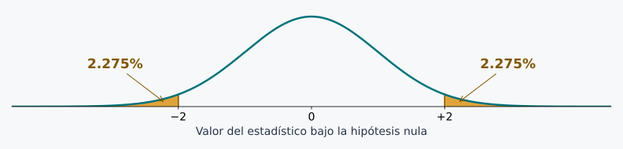
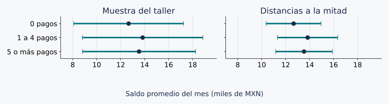
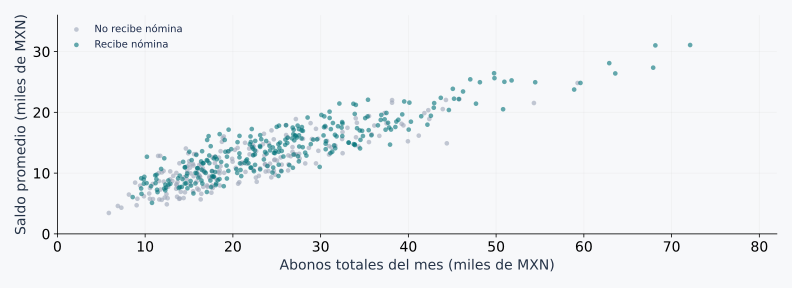
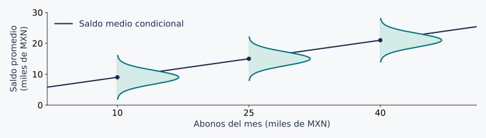
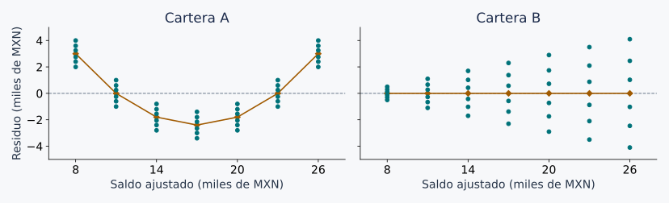

## De la muestra<br>a la inferencia {.portada}

<div class="logo-portada"></div>

```{ojs}
//| echo: false
//| output: false
import { liveBootstrap } from './assets/live-bootstrap.js'
```

::: {.kicker}
TALLER 1 · EVALUACIÓN DE IMPACTO · SESIÓN 01
:::

::: {.lead}
Cómo convertir una diferencia observada en una conclusión estadística: pregunta, estimación, incertidumbre e interpretación.
:::

::: {.pill}
R y Python ejecutables · Stata para uso local
:::

::: {.small .muted}
Cuentas de depósito a la vista y pagos con débito como contexto. Todos los registros son sintéticos; no representan cifras de una institución ni del sistema financiero.
:::

::: {.notes}
0 a 3 min · Caso y ruta. Presentar la pregunta que conecta la sesión: qué parte de una diferencia observada podemos distinguir de la variabilidad de muestreo. Mantener el orden del temario: pruebas de hipótesis, comparación de medias y proporciones, correlación y regresión simple. La inspiración pedagógica de Foulis consiste en construir cada explicación antes de formalizarla; no reemplaza el syllabus.
:::

## Una pregunta bancaria que requiere inferencia

Un equipo quiere saber si los clientes que reciben nómina mantienen un **saldo promedio mensual distinto** al de quienes no la reciben. También quiere comparar su uso de la tarjeta de débito y estudiar cómo se relacionan los abonos con el saldo.

La **población de referencia** son 12,000 clientes sintéticos con una cuenta cada uno. La **muestra** es el subconjunto de 480 clientes que seleccionamos al azar. Cada fila resume su cuenta en septiembre de 2026. Escribiremos $N=12{,}000$ para el tamaño poblacional y $n=480$ para el muestral.

::: {.takeaway}
Usar la muestra para aprender sobre la población es hacer **inferencia estadística**. Como otra selección de clientes puede dar otro resultado, debemos cuantificar esa incertidumbre antes de concluir.
:::

::: {.notes}
La unidad es cliente-mes, pero solo hay un mes: corte transversal, no panel. Los montos están en miles de MXN; los conteos corresponden a operaciones. Una persona con diez transferencias no equivale a diez clientes independientes. El marco contiene clientes con cuenta a la vista y débito. La población de referencia es ese marco didáctico. Selección aleatoria de la muestra no implica recepción aleatoria de nómina.
:::

## ¿Qué preguntas podremos responder? {#cuatro-temas-un-mismo-razonamiento}

| Pregunta sobre las cuentas | Herramienta |
|---|---|
| Si esperamos un saldo menor con nómina, ¿qué resultado contaría como evidencia? | Pruebas de hipótesis de una y dos colas |
| ¿Difiere el saldo medio entre dos grupos? ¿Y entre tres? | Comparación de dos medias y [ANOVA](#anova) |
| ¿Difiere la dispersión de los saldos entre los tres grupos? | Pruebas de varianzas |
| ¿Qué fracción de clientes pagó con débito en cada grupo? | Comparación de proporciones |
| Cuando los abonos son mayores, ¿cómo tienden a ser los saldos? | Correlación |
| ¿Cuántos pesos de diferencia en saldo se asocian con 1,000 MXN más de abonos? | Regresión lineal simple |

::: {.takeaway}
Al terminar podrás **elegir un método a partir de la pregunta** y explicar al equipo qué conclusión respaldan los datos.
:::

::: {.notes}
Pedir que comparen las preguntas sobre saldo medio y dispersión. En el repaso de una hora, ejecutar los laboratorios 3 y 4 en un lenguaje. En los demás, trabajar con las figuras, predicciones y resultados visibles. Sus tres versiones quedan disponibles para la práctica individual.
:::

## Qué miden las variables que vamos a contrastar

| Papel en el análisis | Variable y significado |
|---|---|
| **Grupo de comparación** | `recibe_nomina`: 1 si recibió un abono identificado como nómina; 0 si no. |
| **Resultado continuo: un monto** | `saldo_promedio_miles`: saldo promedio mensual de la cuenta, en miles de MXN. |
| **Resultado binario: solo 0 o 1** | `pago_debito`: 1 si hizo algún pago con la tarjeta de débito; 0 si no. |
| **Variable explicativa** | `abonos_miles`: importe total de entradas del mes, por todos los canales, en miles de MXN. |
| **Actividad de la cuenta** | `n_entradas` y `n_salidas`: conteos totales, desglosados por tipo/canal en la siguiente slide. |

::: {.small}
Una cuenta de depósito a la vista por cliente. Los conteos miden operaciones; los abonos suman dinero recibido durante el mes; el saldo promedio resume cuánto dinero se mantiene en la cuenta.
:::

::: {.notes}
3 a 18 min · De las variables a las pruebas de hipótesis. El objeto de estudio es la cuenta; la tarjeta de débito es un medio para disponer de sus fondos. No se modelan compras con crédito. El indicador pago_debito incluye únicamente pagos; los retiros se registran aparte, aunque utilicen la misma tarjeta. La nómina clasifica el origen de un abono, no un canal adicional. El saldo medio mensual no equivale a un saldo final ni se obtiene restando conteos. Una cuenta por cliente es una simplificación explícita del marco sintético, no una descripción de la tenencia real de productos.
:::

## Entradas y salidas de una cuenta de depósito a la vista

Cada operación se cuenta **una vez en su tipo/canal y sentido**. Los totales `n_entradas` y `n_salidas` suman las columnas correspondientes; no se vuelven a sumar como otro canal.

| Tipo/canal | Entradas a la cuenta | Salidas de la cuenta |
|---|---|---|
| SPEI | `n_spei_entrada` | `n_spei_salida` |
| Ventanilla | `n_abonos_ventanilla` | `n_retiros_ventanilla` |
| Cajero | `n_abonos_cajero` | `n_retiros_cajero` |
| Comisionista | `n_abonos_comisionista` | `n_retiros_comisionista` |
| Compras con débito | (No aplica) | `n_pagos_debito` |
| Otros movimientos | `n_otros_abonos` | `n_otros_cargos` |

::: {.small}
Catálogo didáctico. «Otros» incluye movimientos como traspasos internos o domiciliaciones. La nómina se cuenta en el canal por el que llegó; no se duplica como otra entrada.
:::

::: {.notes}
El catálogo es una simplificación, no una clasificación regulatoria exhaustiva. Cajeros de entrada son receptores de depósitos; no todos los cajeros lo son. La disponibilidad de operaciones en comisionistas depende del servicio y entidad. En la simulación, una nómina se asigna a SPEI o a otro abono interno, nunca a ambos. Los conteos no descomponen los importes por canal y no se simula un libro diario conciliado. Un retiro de cajero se cuenta en n_retiros_cajero, no también en n_pagos_debito. Ver fuentes conceptuales de Banxico y CONDUSEF en la guía docente.
:::

## 1 · Pruebas de hipótesis: definir la afirmación

Un **parámetro** es una cantidad que describe a la población. Aquí $\mu_1$ es el saldo medio de todos los clientes con nómina y $\mu_0$ el de todos los clientes sin nómina. Nos interesa su diferencia: **$\Delta=\mu_1-\mu_0$**, en miles de MXN.

La **hipótesis nula**, $H_0$, afirma igualdad de medias. La **alternativa**, $H_1$, afirma que difieren. Es **bilateral** porque admite diferencias positivas o negativas:

::: {.equation}
$$H_0:\Delta=0 \qquad\text{frente a}\qquad H_1:\Delta\neq0.$$
:::

::: {.takeaway}
Una **prueba o contraste de hipótesis** evalúa qué tan compatibles son los datos con $H_0$, bajo los supuestos del método. No establece qué mecanismo causó una diferencia.
:::

::: {.notes}
Formular la pregunta antes de ver resultados. Mantener el contraste grupo 1 menos grupo 0. Las hipótesis se refieren a parámetros poblacionales, no a la igualdad exacta de dos medias ya observadas. Elegir la alternativa bilateral antes de mirar el signo. Reservar alfa y su interpretación hasta explicar la variabilidad del estadístico.
:::

## Del parámetro a la estimación

El parámetro es fijo para la población y el mes definidos. Un **estimador** es una regla para aproximarlo con la muestra; su valor calculado es una **estimación**.

Sea $Y_i$ el saldo del cliente $i$ y $g$ su grupo: 1 con nómina, 0 sin nómina. Con $n_g$ clientes, calculamos la media $\bar Y_g$ sumando sus saldos y dividiendo entre $n_g$. El signo $\sum$ indica esa suma; el sombrero en $\widehat\Delta$ indica una estimación:

::: {.equation}
$$\mu_g\quad\longrightarrow\quad\bar Y_g=\frac{1}{n_g}\sum_{i\in g}Y_i,
\qquad
\Delta\quad\longrightarrow\quad\widehat\Delta=\bar Y_1-\bar Y_0.$$
:::

Al seleccionar otros clientes cambian las medias y su diferencia. Incluso si $H_0$ fuera cierta, **cada muestra podría producir una diferencia distinta de cero**.

::: {.takeaway}
Para decidir si una diferencia es inusual necesitamos conocer cuánto varía su estimador al repetir el muestreo.
:::

::: {.notes}
Distinguir estimador (regla aleatoria antes de muestrear) de estimación (valor realizado). El muestreo es aleatorio simple sin reemplazo. Primero ilustraremos la distribución muestral de una media; después combinaremos la incertidumbre de dos medias. La población de referencia se define antes del análisis.
:::

## Laboratorio 1 · Identificar muestra y grupos {.lab}

::: {.prompt}
Cuenta clientes por grupo y calcula los promedios: esos serán los insumos de nuestros contrastes.
:::

::: {.panel-tabset group="lenguaje"}
### R

```{webr}
#| exercise: explorar-r
d <- read.csv("datos/muestra.csv")
print(head(d[, c("id_cliente", "recibe_nomina", "abonos_miles",
                 "saldo_promedio_miles", "n_entradas", "n_salidas")], 4))
cat("Clientes:", nrow(d), "\n")
print(table(d$recibe_nomina))
print(aggregate(saldo_promedio_miles ~ recibe_nomina, data = d, FUN = mean))
```

### Python

```{pyodide}
#| exercise: explorar-py
import pandas as pd
d = pd.read_csv("datos/muestra.csv")
cols = ["id_cliente", "recibe_nomina", "abonos_miles",
        "saldo_promedio_miles", "n_entradas", "n_salidas"]
print(d[cols].head(4).to_string(index=False))
print("Clientes:", len(d))
print(d.recibe_nomina.value_counts().sort_index())
print(d.groupby("recibe_nomina")["saldo_promedio_miles"].mean())
```

### Stata

::: {.small .muted}
Referencia para copiar y ejecutar en Stata local. No se ejecuta en estas slides.
:::

```stata
import delimited "datos/muestra.csv", clear
list id_cliente recibe_nomina abonos_miles saldo_promedio_miles n_entradas n_salidas in 1/4
count
tabulate recibe_nomina
tabstat saldo_promedio_miles, by(recibe_nomina) statistics(n mean)
```
:::

::: {.small}
Al agrupar las 480 cuentas aparecen **274 con nómina** y **206 sin nómina**. En R y Python, **Run Code** ejecuta el ejemplo y **Start Over** lo restaura.
:::

::: {.notes}
En plenaria, leer el recuento visible. Resultado al ejecutar: 274 clientes con nómina y 206 sin nómina; saldos medios 14.367800 y 11.822831. Observar que ya tenemos una estimación, pero aún no su precisión. Reservar el promedio de pago_debito hasta explicar por qué una media de ceros y unos es una proporción. Cada laboratorio funciona por separado. R/Python requieren internet en la primera carga; si la red impide descargar los runtimes, continuar con figuras y resultados de referencia. Stata es código para uso local y no se ha ejecutado en este entorno.
:::

## Repetir la muestra explica por qué hay incertidumbre

En el laboratorio obtuvimos dos saldos medios. Si hubiéramos elegido otros clientes, ¿cuánto cambiarían esos promedios? Sigamos primero **una sola media**. Cada vez que extraigas una muestra de la población ilustrativa, el **histograma** registrará dónde cae su media.

<div class="concept-demo" data-demo="muestreo"></div>

::: {.small}
Las barras cuentan cuántas medias caen en cada rango y aproximan su **distribución muestral**. Al pasar de 40 a 200 clientes por muestra, ¿esperas que las medias se concentren o se dispersen más?
:::

::: {.notes}
Extraer una muestra y luego animar 20; comparar n = 40 y n = 200. La minipoblación de 400 clientes es distinta del CSV. Aumentar n reduce variación de muestreo bajo este diseño, pero no corrige selección sesgada. La media poblacional no cambia. Una diferencia de medias también tiene distribución muestral; después calcularemos su error estándar.
:::

## El error estándar convierte la variación en una escala

**Dentro de cada muestra** se dispersan los saldos. Su **desviación estándar (DE)**, $s$, mide esa dispersión alrededor de la media en las unidades del saldo. Su cuadrado es la **varianza**, $s^2=\sum_i(Y_i-\bar Y)^2/(n-1)$.

**Entre muestras** se dispersan las medias del histograma. La DE de un estimador al repetir el muestreo es su **error estándar (EE)**. Para la media de septiembre estimamos el EE ($SE$, por *standard error*) con las 480 cuentas.

::: {.equation}
$$\widehat{SE}(\bar Y)\approx\frac{s}{\sqrt n}
=\frac{4.737}{\sqrt{480}}=0.216\ \text{miles de MXN}.$$
:::

En septiembre, **4,737 MXN** miden la dispersión entre clientes y **216 MXN** la incertidumbre de la media estimada.

::: {.small .muted}
Tratamos los saldos de distintos clientes como aproximadamente independientes. Omitimos el pequeño ajuste por muestreo sin reemplazo, $\sqrt{1-n/N}\approx0.98$.
:::

::: {.notes}
Para observaciones iid, Var(media) = sigma²/n. En muestreo sin reemplazo, usando s, se multiplica s/raíz(n) por raíz(1−n/N); aquí omitimos esa corrección de aproximadamente 0.98. Distinguir dispersión individual de variabilidad del estimador. Si hay dependencia, la fórmula iid no basta; se estudia en inferencia aplicada. No presentar la raíz de n como una ley sin condiciones.
:::

## Laboratorio 2 · Variación entre muestras {.lab}

::: {.prompt}
Con los 12,000 saldos de septiembre, calcula 300 medias usando 40 clientes por muestra. Repite con 200. ¿Qué le ocurre al error estándar?
:::

::: {.panel-tabset group="lenguaje"}
### R

```{webr}
#| exercise: muestreo-r
pob <- read.csv("datos/poblacion_saldos.csv")$saldo_promedio_miles
set.seed(42)
n <- 40  # prueba 200; debe ser menor que length(pob)
medias <- replicate(300, mean(sample(pob, n, replace = FALSE)))
cat("DE de medias:", round(sd(medias), 3), "miles de MXN\n")
par(mar = c(4, 4, 1, 1))
hist(medias, breaks = 20, col = "#007279", border = "white",
     xlim = c(10, 16), main = "", xlab = "Media del saldo (miles de MXN)")
abline(v = mean(pob), col = "#B26A00", lwd = 3)
```

### Python

```{pyodide}
#| exercise: muestreo-py
import numpy as np
import pandas as pd
import matplotlib.pyplot as plt
pob = pd.read_csv("datos/poblacion_saldos.csv").saldo_promedio_miles.to_numpy()
rng = np.random.default_rng(42)
n = 40  # prueba 200; debe ser menor que len(pob)
medias = [rng.choice(pob, n, replace=False).mean() for _ in range(300)]
print(f"DE de medias: {np.std(medias, ddof=1):.3f} miles de MXN")
fig, ax = plt.subplots(figsize=(9, 3.2))
ax.hist(medias, bins=20, color="#007279", edgecolor="white")
ax.axvline(pob.mean(), color="#B26A00", linewidth=3)
ax.set(xlim=(10, 16), xlabel="Media del saldo (miles de MXN)", ylabel="Frecuencia")
fig.tight_layout()
plt.show()
```

### Stata

::: {.small .muted}
Referencia para copiar y ejecutar en Stata local. No se ejecuta en estas slides.
:::

```stata
* Cada repetición vuelve a leer el marco; sample ..., count usa muestreo sin reemplazo.
import delimited "datos/poblacion_saldos.csv", clear
quietly summarize saldo_promedio_miles
local mu = r(mean)
capture program drop media_muestra
program define media_muestra, rclass
    import delimited "datos/poblacion_saldos.csv", clear
    sample 40, count
    quietly summarize saldo_promedio_miles
    return scalar media = r(mean)
end
* Cambia 40 por 200 dentro del programa y vuelve a ejecutar todo este bloque.
simulate media=r(media), reps(300) seed(42) nodots: media_muestra
summarize media
histogram media, frequency xline(`mu') xscale(range(10 16)) ///
    xtitle("Media del saldo (miles de MXN)")
```
:::

::: {.small}
**Práctica complementaria.** Línea ámbar: media poblacional. La DE entre réplicas aproxima el EE de la media.
:::

::: {.notes}
Práctica individual de simulación. La animación anterior cubre la intuición necesaria para continuar. El código usa el marco de 12,000 clientes y mantiene el eje 10 a 16 para comparar dispersión. Al pasar de n = 40 a 200, la DE de medias cae aproximadamente por un factor de raíz de 5, con pequeña corrección finita. Las semillas no producen realizaciones idénticas entre lenguajes. En Stata cambiar sample 40 por sample 200 dentro del programa y ejecutar todo el bloque.
:::

## ¿Qué tan lejos de cero quedó la estimación?

Al cambiar la muestra, también cambia la **resta** de las medias con y sin nómina. Imaginemos una diferencia de **1,000 MXN** con un EE de **500 MXN**. ¿Está lejos de cero? El **estadístico de prueba** expresa esa distancia en errores estándar.

$$\frac{\text{diferencia estimada}-\text{diferencia bajo }H_0}{\text{error estándar de la diferencia}}
=\frac{1{,}000-0}{500}=+2.$$

¿Es frecuente quedar a esa distancia? La **distribución de referencia** describe qué valores tomaría el estadístico al repetir el muestreo bajo $H_0$.

::: {.two-up .small}
::: {.story-card}
**Normal estándar**

Es una campana simétrica con media 0 y desviación estándar 1. La escribimos $Z$. Su 95% central va de −1.96 a +1.96.
:::
::: {.story-card}
**t de Student**

Al estimar la dispersión, esta referencia da más peso a valores extremos. Los **grados de libertad** resumen la información que queda tras estimar parámetros y determinan la forma de la curva.
:::
:::

::: {.notes}
Las cifras son un ejemplo redondo. En la siguiente slide supondremos una referencia normal para visualizar probabilidades. Para una media de observaciones normales independientes, estandarizada por s/raíz(n), la referencia t es exacta. Sus grados de libertad son n−1: las desviaciones respecto de la media muestral suman cero. Al aumentar los grados de libertad, t se aproxima a la normal. Welch se presentará con su propia referencia y con los saldos observados.
:::

## ¿Qué cuenta como «al menos tan extremo»?

Supón que bajo $H_0$ el estadístico sigue la normal estándar. Observamos **+2** y la pregunta admite diferencias en ambas direcciones. De tres posibles resultados, **−2.3, +1.8 y +2.4**, ¿cuáles quedan al menos tan lejos de cero como el observado?

::: {.fragment}
**−2.3 y +2.4.** Contamos los resultados a la izquierda de −2 y a la derecha de +2. Esas regiones se llaman **colas**. Su área conjunta da el **valor p bilateral** bajo $H_0$ y los supuestos del método.

{width=70% fig-alt="Campana normal centrada en cero, con las dos colas sombreadas desde menos dos y más dos errores estándar."}

Las barras miden distancia a cero. Bajo $H_0$, el área sombreada es $p=P_{H_0}(|Z|\geq 2)\approx0.0455$. Esperaríamos un resultado así de extremo o más en unas **455 de cada 10,000 repeticiones**.
:::

::: {.notes}
Dar unos segundos para elegir antes de revelar. Las barras indican distancia a cero. Bajo la hipótesis y el modelo, alrededor del 4.55% de las repeticiones producirían un estadístico al menos así de extremo. El cálculo condiciona en H₀; no da una probabilidad de H₀ dados los datos. Si cambia la referencia a una t, cambian las áreas, aunque se siga comparando en los dos sentidos.
:::

## La alternativa decide qué cola cuenta

Contamos dos colas porque preguntamos si los saldos medios eran **distintos**. ¿Qué habría cambiado si, antes de ver los datos, el equipo hubiera preguntado si el saldo medio era **menor con nómina**?

::: {.prompt}
Si $\Delta=$ **media con nómina menos media sin nómina**, ¿qué signo y qué cola apoyarían esa sospecha?
:::

::: {.fragment}
Buscaríamos valores negativos. Supón que observamos **$z=+2$** bajo la referencia normal.

| Saldo con nómina | $H_0$ | $H_1$ | Área bajo $\Delta=0$ | $p$ |
|------------------|----------|----------|-------------------------------------|-------:|
| **Menor** | $\Delta\ge 0$ | $\Delta<0$ | Izquierda de $+2$ | 0.9772 |
| **Mayor** | $\Delta\le 0$ | $\Delta>0$ | Derecha de $+2$ | 0.0228 |
| **Distinto** | $\Delta=0$ | $\Delta\ne 0$ | Izquierda de $-2$ y derecha de $+2$ | 0.0455 |
:::

::: {.small .fragment}
El $+2$ aporta poca evidencia de un saldo menor. Al invertir la resta, $z=-2$ y la misma pregunta usa la cola derecha. Su $p$ sigue siendo **0.9772**.
:::

::: {.notes}
Pedir el signo antes del primer avance. Después de mostrar la tabla, invertir el orden de la resta en voz alta y pedir una nueva predicción antes del segundo avance. Comprobar que el grupo pueda explicar qué cambia (signo y cola) y qué se conserva (pregunta y valor p). Calibramos las dos pruebas unilaterales en la frontera Delta = 0. El resultado es hipotético. Esta secuencia se inspira en la lección 18, A/B Testing, de Data 8 de UC Berkeley. Aquí la distribución de referencia es normal.
:::

## Una regla de decisión también puede equivocarse

En el ejemplo bilateral obtuvimos $p=0.0455$. ¿Basta para rechazar la igualdad? Antes de ver los datos fijamos un **nivel de significancia**, $\alpha$, y acordamos rechazar $H_0$ si $p<\alpha$. Con **$\alpha=0.05$**, el ejemplo cae en la región de rechazo. Bajo $H_0$ y los supuestos, esta regla rechaza por error en aproximadamente el 5% de las repeticiones.

| Decisión con la muestra | $H_0$ verdadera | $H_0$ falsa |
|---|---|---|
| Rechazar $H_0$ | Error tipo I; controlado por $\alpha$ | Detección de una diferencia |
| No rechazar $H_0$ | Decisión correcta | Error tipo II; puede faltar precisión |

::: {.takeaway}
No rechazar igualdad no demuestra que las medias sean iguales. Para distinguir una diferencia pequeña de una estimación imprecisa, necesitamos acompañarla de un rango que exprese su incertidumbre.
:::

::: {.notes}
Alfa se fija antes; p se calcula después. El error tipo II depende de cuál alternativa sea verdadera, de la variabilidad y de n. Poder es la probabilidad de rechazar la nula bajo una alternativa especificada; su desarrollo corresponde a sesiones posteriores. No rechazar no prueba equivalencia. Un p pequeño no garantiza importancia económica ni validez de los supuestos.
:::

## Un intervalo muestra magnitud y precisión

¿Cómo construimos ese rango? Empecemos con el saldo medio de las 480 cuentas. A los 13.276 mil MXN de la muestra les sumamos y restamos un margen de incertidumbre. Así obtenemos un **intervalo de confianza (IC)** para la media poblacional $\mu$.

El margen es **valor crítico × error estándar**. El crítico $t_{0.975,n-1}$ deja 2.5% de probabilidad en cada cola de la t: con $n-1=479$ grados de libertad vale aproximadamente 1.965.

::: {.equation}
$$IC_{95\%}(\mu)=\bar Y\pm t_{0.975,n-1}\widehat{SE}(\bar Y)
=13.276\pm1.965(0.216)=[12.85,\,13.70].$$
:::

El intervalo estima una **media poblacional**, en miles de MXN; no pretende contener al 95% de los saldos individuales. El 95% se refiere a cuántas veces el procedimiento cubriría la media al repetir el muestreo, como veremos enseguida.

::: {.small}
Cuando prueba e intervalo usan el mismo método, una prueba bilateral al 5% rechaza los valores que quedan fuera de su IC del 95%.
:::

::: {.notes}
El intervalo t es exacto con datos normales iid; aquí es una aproximación para la media con n = 480. Crítico t con 479 grados de libertad: 1.964928; IC completo [12.850717, 13.700451]. La equivalencia prueba/intervalo requiere el mismo procedimiento. La prueba de proporciones de esta sesión usa EE agrupado y el IC Wald no agrupado: no son inversiones exactas uno del otro. No exigir normalidad individual como requisito universal de toda inferencia asintótica.
:::

## La confianza corresponde al procedimiento

Ahora repetimos **muestra → media → intervalo**. La línea ámbar fija el parámetro; cada línea horizontal es el intervalo de una muestra diferente.

<div class="concept-demo" data-demo="intervalos"></div>

::: {.small}
Un procedimiento de cobertura 95% cubre al parámetro en aproximadamente 95% de muchas repeticiones. Una tanda de 40 u 80 intervalos puede cubrir más o menos.
:::

::: {.notes}
Esta demostración usa normalidad y sigma conocida: media ± 1.96 sigma/raíz(n), distinta del intervalo t calculado con el CSV. Explicar qué permanece fijo y qué cambia. Una vez observado un intervalo, el parámetro fijo queda dentro o fuera; el 95% corresponde al procedimiento. No exigir cobertura exacta en una tanda corta. Para procedimientos duales, no cubrir al parámetro verdadero corresponde a rechazarlo mediante la prueba asociada.
:::

## Comprobemos la interpretación {.checkpoint}

Volvamos a la diferencia de saldo por nómina. Si su intervalo del 95% excluye cero y la prueba bilateral correspondiente da $p<0.05$, ¿qué puede concluir el equipo?

<div class="quiz">
<button type="button" data-correct="false" data-feedback="p se calcula suponiendo H0 y el modelo de muestreo. No invierte ese condicionamiento para obtener la probabilidad de H0 dados los datos.">La probabilidad de que la hipótesis nula sea verdadera es menor a 5%.</button>
<button type="button" data-correct="true" data-feedback="La regla rechaza H0 al 5% porque el estadístico observado está en una región poco probable bajo la nula. Todavía deben interpretarse magnitud, precisión y supuestos.">Rechazamos H₀ al 5%, bajo los supuestos de la prueba; falta interpretar la magnitud de la diferencia.</button>
<button type="button" data-correct="false" data-feedback="La hipótesis contrasta igualdad, no un mecanismo causal. Recibir nómina puede relacionarse con otras características de los clientes.">Recibir nómina causa un aumento del saldo y la prueba mide ese efecto.</button>
<p class="quiz-feedback" aria-live="polite"></p>
</div>

::: {.notes}
Pedir una explicación del condicionamiento, no solo la opción elegida. Ya tenemos afirmación poblacional, estimador, escala de incertidumbre y regla de decisión. El siguiente bloque implementa ese mismo esquema para comparar saldos. Primero consideramos dos medias, luego tres medias y la dispersión dentro de esos mismos grupos. Por último cambiamos el resultado a un indicador binario de pago.
:::

## 2 · Comparar medias: aplicar el contraste al saldo

La pregunta pendiente es de magnitud. Con las 274 cuentas con nómina y las 206 sin nómina de septiembre, ¿en cuántos pesos estimamos la diferencia de saldo medio, $\Delta=\mu_1-\mu_0$? Al equipo le interesa saber si la evidencia permite situarla por encima de **3,000 MXN**.

{width=80%}

::: {.small}
Cada barra muestra la incertidumbre de una media. Para comparar los grupos necesitamos el intervalo de **la resta**, que reúne la incertidumbre de ambas.
:::

::: {.notes}
18 a 24 min · Dos medias. Con nómina: n = 274, media 14.367800, DE 4.872256. Sin nómina: n = 206, media 11.822831, DE 4.136204. Los grupos son clientes distintos y se tratan como aproximadamente independientes. No usar el traslape de intervalos individuales como prueba de la diferencia. Tampoco interpretar los intervalos como la distribución de saldos dentro de cada grupo.
:::

## Welch: combinar la incertidumbre de las dos medias

Las medias de saldo difieren en 2.545 mil MXN. ¿Cuánto podría variar su resta entre muestras? Para cada grupo calculamos $v_g=s_g^2/n_g$ (la varianza estimada de su media). Las DE son 4.8723 mil MXN con nómina y 4.1362 mil MXN sin nómina.

::: {.equation}
$$v_1=\frac{s_1^2}{274}\approx0.0866382,\qquad
v_0=\frac{s_0^2}{206}\approx0.0830495.$$
:::

Como los grupos son independientes, el EE de la diferencia es $\sqrt{v_1+v_0}\approx0.412$. La diferencia observada queda a $t=2.545/0.412\approx6.18$ errores estándar de cero.

¿Con qué distribución t comparamos ese 6.18? Cada grupo aporta sus propios grados de libertad (274 menos 1 y 206 menos 1). **Welch** los combina según la contribución de cada grupo a la varianza. El resultado es aproximado y puede ser decimal.

$$\nu=\frac{(v_1+v_0)^2}{v_1^2/273+v_0^2/205}\approx470.9496\quad\text{(470.9 a un decimal).}$$

::: {.notes}
Cálculos con los datos del CSV antes de redondear (diferencia 2.54496905, EE 0.4119316584, t = 6.17813417 y 470.949592 grados de libertad). La aproximación de Satterthwaite permite que cada grupo tenga su propia varianza. Los grados de libertad efectivos determinan la curva t para el valor p y el intervalo. Con mediciones pareadas importa la covarianza y cambia el método. Omitimos la corrección finita pequeña. R, SciPy y Stata con la opción unequal reproducen el cálculo. [Fórmula en el manual del NIST](https://www.itl.nist.gov/div898/handbook/prc/section3/prc31.htm).
:::

## Laboratorio 3 · Comparación de medias {.lab}

::: {.prompt}
Usa Welch para recuperar la diferencia **con nómina menos sin nómina** y su IC en pesos. Para detectar cualquier diferencia, lee el $p$ bilateral. ¿Cuál leerías si desde el inicio se buscara un saldo menor con nómina?
:::

::: {.panel-tabset group="lenguaje"}
### R

```{webr}
#| exercise: medias-r
d <- read.csv("datos/muestra.csv")
y1 <- d$saldo_promedio_miles[d$recibe_nomina == 1]
y0 <- d$saldo_promedio_miles[d$recibe_nomina == 0]
prueba <- t.test(y1, y0, alternative = "two.sided", var.equal = FALSE)
cat("Grados de libertad de Welch:", round(unname(prueba$parameter), 4), "\n")
cat("Diferencia (miles de MXN):", mean(y1) - mean(y0), "\n")
cat("IC 95%:", prueba$conf.int, "\n")
t_obs <- unname(prueba$statistic)
p <- c(izquierda = pt(t_obs, prueba$parameter),
       bilateral = prueba$p.value,
       derecha = pt(t_obs, prueba$parameter, lower.tail = FALSE))
print(p, digits = 12)
```

### Python

```{pyodide}
#| exercise: medias-py
import pandas as pd
from scipy import stats
d = pd.read_csv("datos/muestra.csv")
y1 = d.loc[d.recibe_nomina == 1, "saldo_promedio_miles"]
y0 = d.loc[d.recibe_nomina == 0, "saldo_promedio_miles"]
prueba = stats.ttest_ind(y1, y0, equal_var=False, alternative="two-sided")
print(f"Grados de libertad de Welch: {prueba.df:.4f}")
ic = prueba.confidence_interval(confidence_level=0.95)
print(f"Diferencia (miles de MXN): {y1.mean() - y0.mean():.4f}")
print(f"IC 95%: [{ic.low:.4f}, {ic.high:.4f}]")
p_izquierda = stats.t.cdf(prueba.statistic, prueba.df)
p_derecha = stats.t.sf(prueba.statistic, prueba.df)
print(f"p izquierda: {p_izquierda:.12g}; bilateral: {prueba.pvalue:.4g}; derecha: {p_derecha:.4g}")
```

### Stata

::: {.small .muted}
Referencia para copiar y ejecutar en Stata local. No se ejecuta en estas slides.
:::

```stata
import delimited "datos/muestra.csv", clear
* Stata resta el primer grupo menos el segundo: 0 de sin_nomina = recibe_nomina 1.
generate byte sin_nomina = 1 - recibe_nomina
label define grupos_nomina 0 "Con nomina" 1 "Sin nomina", replace
label values sin_nomina grupos_nomina
ttest saldo_promedio_miles, by(sin_nomina) unequal level(95)
* unequal permite varianzas distintas y usa los mismos grados de libertad que R y SciPy.
* La diferencia y el IC se expresan en miles de MXN.
```
:::

::: {.notes}
Cotejar signo y unidades antes de leer p. Diferencia: 2.54497 miles de MXN; IC [1.73552, 3.35442]; p = 1.404e−09. Los objetos prueba de R/SciPy también contienen estadístico y grados de libertad. Stata unequal usa Satterthwaite; su opción welch aplica otra fórmula de grados de libertad. La variable sin_nomina ordena la salida para conservar nómina 1 menos 0. No usar una prueba pareada.
:::

## ¿Qué diferencias de saldo son compatibles con la muestra?

::: {.equation}
$$\widehat\Delta\approx 2{,}545\ \text{MXN},\qquad
IC_{95\%}(\Delta)\approx[1{,}736,\,3{,}354]\ \text{MXN}.$$
:::

::: {.prompt}
Ubiquen **0 MXN** y **3,000 MXN** respecto del intervalo. Comenten en parejas qué representa cada valor. ¿Qué pueden afirmar sobre la dirección de la diferencia? ¿Y sobre el umbral que fijó el equipo?
:::

::: {.fragment}
«En septiembre, el saldo medio fue **2,545 MXN mayor** en las cuentas con nómina. El intervalo excluye cero ($p<0.001$ frente a igualdad) y admite diferencias a ambos lados de 3,000 MXN». Así podemos comunicar la dirección y dejar abierta la pregunta sobre el umbral.
:::

::: {.notes}
Dar 30 segundos por pareja para interpretar ambos valores. Revelar la lectura y pedir que cotejen grupo de referencia, moneda y alcance. El umbral de 3,000 MXN es hipotético. El valor p corresponde al contraste bilateral frente a cero. La regla de Welch para ese contraste coincide con examinar si su IC de 95% excluye cero. Los datos comparan grupos observados en el mismo mes. La estabilidad del ingreso es una posible explicación alternativa.
:::

## De dos medias a tres grupos de clientes {#anova}

Al separar por nómina obtuvimos dos medias y pudimos restarlas. Si agrupamos **las mismas 480 cuentas** por número de pagos con débito, obtenemos tres medias. ¿Cómo evaluar en conjunto si los saldos medios difieren entre los tres tramos?

| Pagos con débito | Clientes en la muestra | Saldo medio | DE del saldo |
|---|---:|---:|---:|
| 0 | 170 | 12.66 | 4.58 |
| 1 a 4 | 82 | 13.83 | 5.02 |
| 5 o más | 228 | 13.53 | 4.72 |

::: {.prompt}
Los saldos están en miles de MXN. ¿Basta con que 13.83 sea la mayor media de la tabla para concluir que su grupo también tiene la mayor media en la población? ¿Qué otra columna ayuda a juzgar esa distancia?
:::

::: {.small .fragment}
Las medias muestrales pueden diferir por azar. El **análisis de varianza (ANOVA)** toma en cuenta la variación dentro de los grupos y sus tamaños. Hace una pregunta global: $H_0$ afirma que las tres medias poblacionales coinciden y $H_1$ que al menos una difiere.
:::

::: {.notes}
24 a 35 min · Tres medias y dispersión. Los tres grupos son disjuntos y corresponden al mismo mes. Pedir al grupo que señale la DE y los tamaños antes de revelar el método. Si las respuestas se centran solo en el orden de las medias, preguntar si las mismas diferencias entre medias serían igual de convincentes con el doble de dispersión dentro de cada grupo. Comparar tres pares por separado al 5% aumenta la probabilidad de al menos un falso rechazo bajo la nula global.
:::

## Las mismas medias con distinta dispersión {#misma-media-distinta-dispersion}

En el panel izquierdo aparecen los tres saldos medios de la tabla. Cada barra se extiende **una desviación estándar** a cada lado de la media de su tramo y muestra cuánto varían los saldos individuales.



::: {.prompt}
El segundo panel conserva las medias y el número de clientes, pero cada saldo queda a mitad de camino entre su valor original y la media de su tramo. ¿En qué panel habría más evidencia de que al menos dos medias poblacionales difieren?
:::

::: {.small .fragment}
**En el segundo.** La separación entre las medias es la misma. Al reducirse la dispersión dentro de cada tramo, esa separación destaca más. El ANOVA cuantifica esta comparación. Volvamos a los saldos de la muestra para calcularla.
:::

::: {.notes}
Pedir que identifiquen qué se mantiene (medias y tamaños) y qué cambia (DE). Si interpretan las barras como intervalos de confianza, recordar que describen a clientes individuales. La figura de la derecha es un escenario didáctico que transforma cada saldo en media de su tramo + 0.5 × (saldo − media de su tramo). Esto divide la varianza interna entre cuatro. En los saldos del CSV el cociente F vale 2.3317 y p = 0.0982. En el escenario vale 9.3269 y p ≈ 0.000106. Para interpretar las cuentas de septiembre, usar los resultados del CSV. El contraste gráfico de variación entre grupos y dentro de ellos se inspira en las figuras 5.2.2 y 5.2.3 de [Universidad de Wisconsin (Madison), Biocore, cap. 5](https://wisc.pb.unizin.org/biocorestatistics/chapter/statistical-inference-comparing-more-than-2-groups/).
:::

## ANOVA contrasta medias con dos medidas de variación

Con los saldos originales de septiembre, medimos la separación **entre** los tres tramos y la dispersión **dentro** de ellos. Al dividir cada suma de distancias al cuadrado entre sus grados de libertad obtenemos un **cuadrado medio**.

| Componente | ¿Qué distancia usamos? | Grados de libertad | Cuadrado medio |
|---|---|---:|---:|
| Entre grupos | De cada media a la global, ponderando por tamaño del grupo | $3-1=2$ | 52.04 |
| Dentro de grupos | De cada saldo a la media de su grupo | $480-3=477$ | 22.32 |

Dividimos el primero entre el segundo: **$F=52.04/22.32\approx2.33$**. Si las medias coinciden, ambos estiman la misma varianza. Una separación grande respecto de la dispersión interna lleva a la **cola derecha**.

::: {.small .fragment}
La referencia clásica supone clientes independientes, normalidad dentro de cada grupo y varianza común. Con 2 y 477 grados de libertad, $p=0.0982$. Al 5%, la evidencia es insuficiente para concluir que difieren las medias poblacionales de saldo.
:::

::: {.notes}
El numerador es el cuadrado medio entre grupos y el denominador el cuadrado medio residual. Bajo H0 y los supuestos tienen la misma esperanza, lo cual no implica que la esperanza del cociente sea exactamente uno. Con varianzas distintas, ANOVA de Welch es una alternativa para comparar medias. Evitar elegir automáticamente entre pruebas con base en un contraste preliminar de varianzas. Si se rechaza la nula global y se quieren localizar diferencias, usar comparaciones ajustadas por multiplicidad.
:::

## Dos pruebas clásicas para la varianza

En el ANOVA usamos la dispersión de los saldos dentro de cada tramo para comparar las medias. Ahora nos interesa **la dispersión misma**. Entre quienes no pagaron, la DE fue de **4.58 mil MXN**. Para contrastar afirmaciones sobre la varianza poblacional $\sigma^2$, usamos la varianza muestral $s^2$.

| Pregunta | Estadístico bajo la igualdad | Referencia |
|---|---|---|
| Entre quienes no pagaron, ¿la DE es de 4 mil MXN? | $(170-1)s_0^2/4^2$ | $\chi^2$ («ji cuadrada») con $169$ grados de libertad |
| ¿La varianza es igual para 5 o más pagos y para cero pagos? | $s_{5+}^2/s_0^2$ | $F$ con $227$ grados de libertad arriba y $169$ abajo |

::: {.small}
Los **4 mil MXN** son una referencia hipotética para la DE. Ambas pruebas requieren independencia y normalidad dentro de los grupos. La asimetría de los saldos limita su interpretación. En estas referencias asimétricas, los dos extremos cuentan contra la igualdad y calculamos el $p$ bilateral duplicando la menor de las dos colas.
:::

::: {.notes}
Una DE en miles de MXN equivale a una varianza en (miles de MXN)². La F de igualdad de varianzas es la razón directa de dos varianzas muestrales con grupos y orden fijados de antemano. La F de ANOVA usa cuadrados medios entre y dentro de grupos para contrastar medias. No seleccionar dinámicamente la mayor varianza como numerador al usar las mismas fórmulas de colas. La normalidad afecta fuertemente a ambas pruebas y los saldos de esta muestra exhiben asimetría.
:::

## ¿Qué tan lejos de su centro están los saldos?

La comparación de varianzas entre cero y cinco o más pagos deja fuera el tramo intermedio. Para incluir **los tres tramos** y reducir la sensibilidad a la asimetría, medimos la distancia de cada saldo a la mediana de su propio grupo.

$$D_{ig}=\lvert Y_{ig}-\operatorname{mediana}_g\rvert.$$

El cliente 36 hizo cinco pagos. Su saldo fue de 8.21 mil MXN y la mediana de su tramo fue 13.25 mil. Aporta una **distancia de 5.04 mil MXN**. Un saldo igual de lejos por encima aportaría esa misma distancia.

::: {.takeaway}
La prueba de **Levene centrada en la mediana** (Brown y Forsythe) aplica el ANOVA a esas distancias. Si un grupo reúne saldos más dispersos, sus distancias tenderán a ser mayores.
:::

::: {.notes}
Formular H0 de varianzas iguales y explicar la referencia F aproximada. Esta variante suele ser más robusta que el cociente F directo frente a la no normalidad. Diferencias fuertes en las formas de las distribuciones también pueden complicar su lectura. Un valor p grande no demuestra homocedasticidad.
:::

## Laboratorio 4 · ¿Media o dispersión? {.lab}

::: {.prompt}
Conserva los tres tramos y sigue qué entra a cada cálculo. ¿Qué salida compara los **saldos medios**? ¿Cuál usa las **distancias a la mediana**? Ejecuta el código. Al 5%, ¿qué puedes concluir sobre las tres medias?
:::

::: {.panel-tabset group="lenguaje"}
### R

```{webr}
#| exercise: anova-varianzas-r
d <- read.csv("datos/muestra.csv")
pagos <- d$n_pagos_debito
grupo <- cut(pagos, breaks = c(-1, 0, 4, Inf), labels = c("0", "1 a 4", "5+"))
saldo <- d$saldo_promedio_miles
print(summary(aov(saldo ~ grupo)))
distancia <- abs(saldo - ave(saldo, grupo, FUN = median))
cat("Levene centrado en la mediana:\n")
print(summary(aov(distancia ~ grupo)))
cero <- saldo[grupo == "0"]
muchos <- saldo[grupo == "5+"]
gl <- length(cero) - 1
chi2 <- gl * var(cero) / 4^2
p_chi2 <- 2 * min(pchisq(chi2, gl), pchisq(chi2, gl, lower.tail = FALSE))
cat("Una varianza: chi2 =", chi2, "p =", p_chi2, "\n")
razon <- var.test(muchos, cero)
cat("Razón de varianzas 5+ / 0: F =", razon$statistic, "p =", razon$p.value, "\n")
```

### Python

```{pyodide}
#| exercise: anova-varianzas-py
import pandas as pd
from scipy import stats

d = pd.read_csv("datos/muestra.csv")
pagos = d.n_pagos_debito
saldo = d.saldo_promedio_miles
cero = saldo[pagos.eq(0)]
pocos = saldo[pagos.between(1, 4)]
muchos = saldo[pagos.ge(5)]
anova = stats.f_oneway(cero, pocos, muchos)
levene = stats.levene(cero, pocos, muchos, center="median")
print(f"ANOVA: F = {anova.statistic:.4f}; p = {anova.pvalue:.4f}")
print(f"Levene (mediana): F = {levene.statistic:.4f}; p = {levene.pvalue:.4f}")
gl = len(cero) - 1
chi2 = gl * cero.var() / 4**2
p_chi2 = 2 * min(stats.chi2.cdf(chi2, gl), stats.chi2.sf(chi2, gl))
print(f"Una varianza: chi2 = {chi2:.4f}; p = {p_chi2:.4f}")
f = muchos.var() / cero.var()
gl_f = (len(muchos) - 1, gl)
p_f = 2 * min(stats.f.cdf(f, *gl_f), stats.f.sf(f, *gl_f))
print(f"Razón de varianzas 5+ / 0: F = {f:.4f}; p = {p_f:.4f}")
```

### Stata

::: {.small .muted}
Referencia para copiar y ejecutar en Stata local.
:::

```stata
import delimited "datos/muestra.csv", clear
generate byte grupo = cond(n_pagos_debito == 0, 0, cond(n_pagos_debito <= 4, 1, 2))
oneway saldo_promedio_miles grupo
robvar saldo_promedio_miles, by(grupo)
* Leer W50, centrado en la mediana.
sdtest saldo_promedio_miles == 4 if grupo == 0
generate byte orden = 2 - grupo
* Primer grupo: 5 o más pagos; segundo: 0 pagos.
sdtest saldo_promedio_miles if inlist(grupo, 0, 2), by(orden)
```
:::

::: {.notes}
Ejecutar un lenguaje en plenaria. El ANOVA toma el saldo en miles de MXN. Levene toma distancias respecto a la mediana de cada grupo. Los tests clásicos usan la varianza muestral con divisor n−1. El orden de la razón de varianzas es 5+ dividido entre 0 en los tres lenguajes. Pedir que comparen poblaciones, hipótesis y supuestos antes de interpretar decisiones.
:::

## ¿Qué contraste responde al equipo? {#elegir-contraste}

Ya comparaste las medias de los tres tramos. Al nivel del 5%, ¿hay evidencia de que los tramos **difieren en la dispersión de sus saldos**? Elige el contraste que responde a esa pregunta.

| Salida del laboratorio | ANOVA | Levene (mediana) | DE frente a 4 mil | Varianzas de 5+ y 0 pagos |
|---|---:|---:|---:|---:|
| Valor $p$ | 0.0982 | 0.5177 | 0.0078 | 0.6975 |

<div class="quiz">
<button data-correct="false" data-feedback="ANOVA usa la variación dentro de los grupos para contrastar sus medias. Aquí la pregunta se refiere a la dispersión.">El ANOVA dio p = 0.0982. Los saldos son igual de dispersos.</button>
<button data-correct="true" data-feedback="Levene compara la dispersión en los tres tramos. Con p = 0.5177, la muestra no permite identificar una diferencia de dispersión al 5%.">Con Levene, la evidencia es insuficiente para afirmar que la dispersión difiere entre tramos.</button>
<button data-correct="false" data-feedback="La ji cuadrada compara la DE de un solo grupo con 4 mil MXN. Para afirmar que ese grupo supera a otro necesitaríamos comparar sus dispersiones.">La prueba frente a 4 mil dio p = 0.0078. El tramo sin pagos es el más disperso.</button>
<p class="quiz-feedback" aria-live="polite"></p>
</div>

::: {.notes}
Pedir a cada pareja su decisión antes de pulsar. Al 5%, ANOVA y Levene no rechazan sus respectivas nulas. Si confunden sus objetivos, volver al código y señalar qué se entrega al ANOVA en cada caso: saldos o distancias a la mediana. Preguntar de nuevo cambiando «dispersión» por «media». La prueba clásica de una DE frente a 4 mil sí rechazaría bajo normalidad; los saldos son asimétricos. Pedir que expliquen por qué hace falta un contraste distinto para responder a cada pregunta.
:::

## Comparar proporciones: el resultado ahora es binario

Hasta aquí, el número de pagos definía tres grupos. Para saber qué tan común fue usar la tarjeta, juntemos los tramos de **1 a 4** y **5 o más** bajo «pagó». De las 274 cuentas con nómina y las 206 sin nómina, ¿qué fracción pagó al menos una vez en cada grupo?

| Clientes | Pagó al menos una vez | No pagó | Total |
|---|---:|---:|---:|
| Con nómina | 220 | 54 | 274 |
| Sin nómina | 90 | 116 | 206 |
| **Total** | **310** | **170** | **480** |

::: {.prompt}
Dos analistas escriben **220/274** y **220/310**. ¿A quiénes describe cada fracción? Elige los dos denominadores que necesitas para comparar el uso de débito por nómina.
:::

::: {.fragment .answer}
De quienes recibieron nómina, pagó el **80.29%** (220/274). Sin nómina pagó el **43.69%** (90/206). La diferencia es **36.60 puntos porcentuales (pp)**. En cambio, 220/310 indica qué fracción de quienes **pagaron** recibió nómina.
:::

::: {.small}
Al codificar «pagó» como 1 y «no pagó» como 0, la media por grupo es su **proporción muestral** $\hat p_g$. Esta estima la proporción poblacional $p_g$.
:::

::: {.notes}
35 a 41 min · Proporciones. Pedir que completen «de cada 100 clientes que…» para cada denominador antes de hacer la resta. Si eligen 310, invitarles a leer el título de esa columna y nombrar quién queda fuera. Si alguien dice «36.60% más», pedir el grupo base de su comparación. La práctica 6 de la Universidad de Granada trabaja los conteos de casos y los tamaños de grupo. Nuestra tabla usa los clientes del CSV.
:::

## Proporciones: dos errores estándar para dos preguntas

¿Son compatibles esos **36.60 pp** con tasas iguales? Bajo $H_0:p_1=p_0$, la tasa común estimada es $310/480=64.58\%$. Entre quienes pagaron, esperaríamos unos **177** clientes del grupo con nómina y **133** del otro. Observamos 220 y 90. Con estos tamaños usamos una referencia normal.

::: {.equation}
$$z=\frac{\hat p_1-\hat p_0}{\sqrt{\hat p(1-\hat p)(1/n_1+1/n_0)}}
=\frac{0.3660}{0.04410}\approx8.30.$$
:::

Para estimar la diferencia, cada grupo aporta su propia proporción al EE. Así construimos el **intervalo de Wald no agrupado** del 95%.

::: {.equation}
$$(\hat p_1-\hat p_0)\ \pm\ 1.96\sqrt{\frac{\hat p_1(1-\hat p_1)}{n_1}+\frac{\hat p_0(1-\hat p_0)}{n_0}}.$$
:::

::: {.notes}
Proporción agrupada 0.6458333; EE bajo H0 0.0441037784; z = 8.29920967. EE del IC: 0.0420924796. Éxitos/fracasos por grupo: 220/54 y 90/116, todos mayores de 10. Es una aproximación normal, sin corrección de continuidad, no un método exacto. Wald puede fallar con muestras pequeñas o proporciones extremas. Prueba e IC usan EE diferentes y no son inversiones exactas. Estas convenciones coinciden en los tres lenguajes.
:::

## Laboratorio 5 · Comparación de proporciones {.lab}

::: {.prompt}
Conserva el orden **con nómina menos sin nómina**. ¿En cuántos puntos porcentuales difieren las proporciones de clientes que pagaron con débito? ¿Qué valores admite el intervalo?
:::

::: {.panel-tabset group="lenguaje"}
### R

```{webr}
#| exercise: proporciones-r
d <- read.csv("datos/muestra.csv")
a <- d$pago_debito[d$recibe_nomina == 1]
b <- d$pago_debito[d$recibe_nomina == 0]
p1 <- mean(a); p0 <- mean(b); n1 <- length(a); n0 <- length(b)
dif <- p1 - p0
se <- sqrt(p1 * (1-p1)/n1 + p0 * (1-p0)/n0)
ic <- dif + c(-1, 1) * qnorm(.975) * se
pool <- (sum(a) + sum(b)) / (n1 + n0)
z <- dif / sqrt(pool * (1-pool) * (1/n1 + 1/n0))
cat("Proporciones (nómina 1, 0):", p1, p0, "\n")
cat("Diferencia e IC (pp):", 100 * c(dif, ic), "\n")
cat("p bilateral:", 2 * pnorm(-abs(z)), "\n")
```

### Python

```{pyodide}
#| exercise: proporciones-py
import numpy as np
import pandas as pd
from scipy import stats
d = pd.read_csv("datos/muestra.csv")
a = d.loc[d.recibe_nomina == 1, "pago_debito"]
b = d.loc[d.recibe_nomina == 0, "pago_debito"]
p1, p0, n1, n0 = a.mean(), b.mean(), len(a), len(b)
dif = p1 - p0
se = np.sqrt(p1*(1-p1)/n1 + p0*(1-p0)/n0)
ic = dif + np.array([-1, 1]) * stats.norm.ppf(.975) * se
pool = (a.sum() + b.sum()) / (n1 + n0)
z = dif / np.sqrt(pool*(1-pool)*(1/n1 + 1/n0))
print(f"Proporciones (nómina 1, 0): {p1:.4f}, {p0:.4f}")
print(f"Diferencia: {100*dif:.2f} pp; IC: {100*ic}")
print(f"p bilateral: {2*stats.norm.sf(abs(z)):.4g}")
```

### Stata

::: {.small .muted}
Referencia para copiar y ejecutar en Stata local. No se ejecuta en estas slides.
:::

```stata
import delimited "datos/muestra.csv", clear
generate byte sin_nomina = 1 - recibe_nomina
label define grupos_nomina 0 "Con nomina" 1 "Sin nomina", replace
label values sin_nomina grupos_nomina
prtest pago_debito, by(sin_nomina) level(95)
* Diferencia: nómina 1 menos nómina 0; multiplica diferencia e IC por 100 para pp.
* La prueba usa una proporción común bajo H0; el IC conserva una por grupo.
```
:::

::: {.small .fragment}
«La proporción de clientes que pagaron con débito fue **36.60 pp mayor** entre quienes recibieron nómina (IC del 95% **[28.35, 44.85] pp**, $p<0.001$ frente a igualdad)». ¿Cómo se relaciona el saldo de cada cuenta con **el importe total de sus abonos**?
:::

::: {.notes}
Interpretar las cifras de la solución visible y dejar la ejecución como práctica. Pedir una frase que incluya denominadores, signo y unidades. Localizar en pool y se la distinción entre EE de la prueba y del IC. p = 1.04806e−16. Stata prtest usa la misma prueba z agrupada y el IC no agrupado. Muchas operaciones de un cliente no sustituyen muchos clientes independientes. Al filtrar, revisar éxitos y fracasos en cada grupo.
:::

## 3 · Correlación: pasar de grupos a dos variables continuas

El grupo con nómina tuvo mayor saldo medio y una mayor proporción de clientes que pagaron con débito. **¿Quienes recibieron más dinero también mantuvieron más saldo?** Cada punto reúne los abonos del mes ($X_i$) y el saldo promedio ($Y_i$) de una de las 480 cuentas.

{width=80%}

::: {.prompt}
Sigue los puntos de izquierda a derecha. ¿En qué dirección cambia el saldo típico y cuánta dispersión ves entre cuentas con abonos parecidos?
:::

::: {.notes}
41 a 46 min · Correlación. Describir dirección, dispersión y observaciones extremas antes de calcular. Un punto es un cliente. Comparamos clientes en un mes; no seguimos cambios individuales a través del tiempo. Los colores muestran nómina, pero no equivalen a controlar por ella. La nube no lleva recta todavía: primero motivamos la asociación lineal.
:::

## Pearson: covariación en una escala comparable

¿Cómo resumir la dirección de la nube? Para cada cuenta, restamos a sus abonos y a su saldo sus respectivas medias. Multiplicamos ambas desviaciones. Signos iguales dan un producto positivo y signos opuestos, uno negativo. La **covarianza**, $s_{XY}$, reúne esos productos.

La **correlación de Pearson**, $r$, divide la covarianza entre el producto de las DE de abonos y saldo. Así se cancelan las unidades.

::: {.equation}
$$s_{XY}=\frac{1}{n-1}\sum_i(X_i-\bar X)(Y_i-\bar Y),
\qquad r=\frac{s_{XY}}{s_Xs_Y}\in[-1,1].$$
:::

Cerca de +1, los puntos se alinean en sentido ascendente. Cerca de −1, en sentido descendente. Intercambiar los ejes conserva $r$.

::: {.takeaway}
Lee $r$ junto con la nube. Una cuenta extrema puede cambiarlo y una relación curva puede dar $r=0$.
:::

::: {.notes}
Pearson requiere variación en ambas variables. En los productos centrados, signos iguales aportan positivamente y signos distintos negativamente. La estandarización elimina unidades. No aplicar umbrales universales de fuerte/débil como reglas de decisión. r = 0.888 no significa 88.8% explicado ni un efecto. Una relación cuadrática simétrica puede tener r = 0: usar como ejemplo oral si surge la duda.
:::

## Laboratorio 6 · Correlación y nube de puntos {.lab}

::: {.prompt}
¿Qué signo tendrá $r$ para estas 480 cuentas? Comprueba tu lectura de la nube. Si expresaras los abonos en pesos en vez de miles de pesos, ¿cambiaría la correlación?
:::

::: {.panel-tabset group="lenguaje"}
### R

```{webr}
#| exercise: correlacion-r
d <- read.csv("datos/muestra.csv")
cat("r de Pearson:", cor(d$abonos_miles, d$saldo_promedio_miles), "\n")
par(mar = c(4, 4, 1, 1))
plot(d$abonos_miles, d$saldo_promedio_miles, pch = 16,
     col = adjustcolor(c("#9BA5B7", "#007279")[d$recibe_nomina + 1], .6),
     xlab = "Abonos del mes (miles de MXN)", ylab = "Saldo promedio (miles de MXN)")
```

### Python

```{pyodide}
#| exercise: correlacion-py
import pandas as pd
import numpy as np
import matplotlib.pyplot as plt
d = pd.read_csv("datos/muestra.csv")
print("r de Pearson:", d.abonos_miles.corr(d.saldo_promedio_miles))
fig, ax = plt.subplots(figsize=(9, 3.2))
colores = np.where(d.recibe_nomina == 1, "#007279", "#9BA5B7")
ax.scatter(d.abonos_miles, d.saldo_promedio_miles, c=colores, alpha=.6, s=14)
ax.set(xlabel="Abonos del mes (miles de MXN)", ylabel="Saldo promedio (miles de MXN)")
fig.tight_layout()
plt.show()
```

### Stata

::: {.small .muted}
Referencia para copiar y ejecutar en Stata local. No se ejecuta en estas slides.
:::

```stata
import delimited "datos/muestra.csv", clear
correlate abonos_miles saldo_promedio_miles
twoway (scatter saldo_promedio_miles abonos_miles if recibe_nomina==0) ///
       (scatter saldo_promedio_miles abonos_miles if recibe_nomina==1), ///
       xtitle("Abonos del mes (miles de MXN)") ///
       ytitle("Saldo promedio (miles de MXN)") ///
       legend(order(1 "Sin nomina" 2 "Con nomina"))
```
:::

::: {.small .fragment}
En septiembre, $r\approx0.888$. Al multiplicar los abonos por 1,000 crecen en igual proporción su DE y su covarianza con el saldo, y $r$ se conserva. ¿Cuántos pesos de diferencia en saldo corresponden a 1,000 MXN de diferencia en abonos?
:::

::: {.notes}
Recuperar la nube y el valor de Pearson de las slides anteriores y dejar el código para la práctica. Preguntar por qué r no tiene unidades. No sustituir la inspección visual por el coeficiente, ni eliminar puntos extremos por conveniencia: primero comprender su origen. La transición a regresión mantiene el CSV y traduce asociación a unidades. R, Python y Stata calculan el mismo Pearson sobre datos sin faltantes.
:::

## 4 · Regresión simple: una relación con dirección y unidades

La cifra en pesos exige elegir qué variable queremos resumir. En las mismas cuentas usaremos el **saldo como resultado $Y$** y los **abonos como variable explicativa $X$**. Planteamos una recta para la población:

::: {.equation}
$$Y_i=\beta_0+\beta_1X_i+u_i.$$
:::

Los **coeficientes** definen la recta. El **intercepto**, $\beta_0$, es su valor en $X=0$. La **pendiente**, $\beta_1$, mide la diferencia de saldo que asigna la recta a dos cuentas separadas por una unidad de $X$. Aquí son **1,000 MXN de abonos**.

El **error**, $u_i$, recoge lo que la recta poblacional deja por explicar del saldo de la cuenta $i$. Para estimar los coeficientes tenemos los 480 pares de septiembre.

::: {.notes}
46 a 56 min · Regresión. Traducir cada pieza de la ecuación al problema bancario. La especificación por sí sola no verifica E[u|X] = 0 ni identifica causalidad. Regresar Y sobre X y X sobre Y son problemas distintos; Pearson sí es simétrico. La CEF se desarrolla en el módulo correspondiente. No confundir un parámetro estructural con la pendiente descriptiva de una regresión que omite factores relevantes.
:::

## La muestra produce una recta y residuos calculables

Tomemos la cuenta 36. Recibió **10,858 MXN** en abonos y mantuvo un saldo promedio de **8,213 MXN**. El saldo que le asigna una recta estimada es su **valor ajustado**, $\widehat Y_i=\hat\beta_0+\hat\beta_1X_i$. Los sombreros identifican las estimaciones muestrales.

::: {.two-up}
::: {.story-card}
**Error poblacional**

$u_i=Y_i-\beta_0-\beta_1X_i$ depende de los parámetros de la ecuación planteada. No lo observamos directamente.
:::
::: {.story-card}
**Residuo muestral**

$\hat u_i=Y_i-\widehat Y_i$ se calcula usando la recta estimada. Es la distancia vertical con signo entre el punto y la recta.
:::
:::

::: {.takeaway}
Si la recta le asigna 8,095 MXN, subestima el saldo en **118 MXN**. El residuo es positivo. Si lo sobreestimara, sería negativo. ¿Qué recta elegiríamos al considerar todas las cuentas?
:::

::: {.notes}
La distinción población/muestra reaparece en los coeficientes, como antes en mu/media y Delta/diferencia. Ejemplo del laboratorio 7: observado 8.2134, ajustado 8.095335 y residuo 0.118065 miles de MXN. Conocemos Y y X, no los parámetros verdaderos ni u. El simulador permite conocer su receta al docente, pero esa ventaja no existe en un análisis ordinario.
:::

## Elegir la recta: observar el costo de cada residuo

Antes de elegir la recta de septiembre, ensaya el criterio en 12 cuentas ilustrativas. Mueve intercepto y pendiente. Si corriges la subestimación en un punto, ¿qué ocurre con las distancias en los demás?

<div class="concept-demo" data-demo="ols"></div>

::: {.small}
Activa **Ver cuadrados** y busca reducir su suma. Después pulsa **Encontrar la recta** para comparar tu elección con la que logra la menor suma posible.
:::

::: {.notes}
Los 12 pares ilustrativos son distintos del CSV. Antes de pulsar Encontrar la recta, preguntar por qué no sumar residuos con signo: pueden cancelarse aunque la recta ajuste mal. Los cuadrados penalizan más las discrepancias grandes. El botón calcula el mínimo para esos puntos. No usar todavía la sigla MCO: el nombre del método se introduce en la siguiente slide, después de entender el criterio. Mover pendiente e intercepto por separado ayuda a distinguir sus funciones.
:::

## Mínimos cuadrados ordinarios

En las 480 cuentas, el criterio de la animación nos da el ajuste por **mínimos cuadrados ordinarios (MCO)**. Para rectas con intercepto $a$ y pendiente $b$, $\min_{a,b}$ elige la que da la menor suma de residuos al cuadrado.

::: {.equation}
$$\min_{a,b}\sum_i(Y_i-a-bX_i)^2,$$
$$\hat\beta_1=\frac{\sum_i(X_i-\bar X)(Y_i-\bar Y)}{\sum_i(X_i-\bar X)^2}
=r\frac{s_Y}{s_X},\qquad \hat\beta_0=\bar Y-\hat\beta_1\bar X.$$
:::

La pendiente multiplica $r$ por la razón entre las DE de saldo y abonos. La recta pasa por $(\bar X,\bar Y)$ y los residuos suman cero **por construcción**.

::: {.small}
Sin variación de abonos no hay una pendiente única. Para llevar el ajuste de septiembre a la población, todavía debemos explicar cómo varían los saldos entre clientes con los mismos abonos.
:::

::: {.notes}
No derivar ecuaciones normales en plenaria; señalar el numerador relacionado con covarianza y el denominador con variación de X. La identidad b1 = r sY/sX conecta pendiente y correlación, conservando las unidades. Con intercepto, la ortogonalidad muestral es mecánica; no verifica exogeneidad poblacional. MCO elige un ajuste, no identifica por sí mismo un efecto causal.
:::

## Una recta, tres distribuciones condicionales {#supuestos-regresion}

Aun con **los mismos abonos**, las cuentas pueden mantener saldos distintos. Cada campana ilustra la **distribución condicional** $Y\mid X=x$ de esos saldos a un nivel fijo de abonos. El ancho horizontal indica densidad.



| Supuesto | Dónde se lee |
|---------------|------------------------------------------|
| **Linealidad de la media** | Los centros $E[Y\mid X=x]$ caen sobre una recta. |
| **Homocedasticidad** | La dispersión **vertical** es la misma en todos los niveles de abonos. |
| **Normalidad condicional** | A cada nivel le corresponde una campana normal. |
| **Independencia condicional** | Fijados los abonos, el saldo de un cliente no informa sobre los demás. Se justifica con el diseño. |

::: {.notes}
Señalar que cada campana dibujada de lado es una densidad vertical a X fijo; su extensión horizontal representa densidad y no más valores de X. El gráfico marginal de Y o de X no verifica la normalidad condicional. El dibujo ilustra tres distribuciones individuales; la independencia es una propiedad conjunta que esas tres campanas no pueden demostrar. En el modelo clásico, condicional a todo el vector X, los errores son independientes. Repetir clientes, compartir choques por sucursal o usar datos de familias puede inducir dependencia. En nuestro caso didáctico usamos una fila por cliente y la aproximación de independencia de la muestra aleatoria simple con fracción pequeña.
:::

## Qué permite cada supuesto de la regresión

En la figura, cada campana se centra en el **saldo medio condicional**, $\beta_0+\beta_1x$. Esto supone que el error promedia cero a cada nivel de abonos, $E[u\mid X=x]=0$. Con errores normales de varianza común $\sigma^2$, el modelo del saldo individual es

$$Y_i\mid X_i=x_i\sim \mathcal N(\beta_0+\beta_1x_i,\sigma^2).$$

Cada saldo sigue siendo una variable aleatoria a abonos fijos. La independencia dice cómo se relacionan los saldos de **distintos clientes**. Con muestreo aleatorio, variación en $X$ y media condicional del error cero, MCO acierta en promedio al repetir muestras (**insesgadez**).

En septiembre, la **estabilidad del ingreso** se relaciona con abonos y saldo. Si la omitimos, el promedio del error puede variar con $X$ y la pendiente puede recoger parte de esa relación.

::: {.takeaway}
Una **interpretación causal** diría qué pasaría al intervenir sobre los abonos. Con estas cuentas podemos examinar qué tan bien describe la recta la asociación observada.
:::

::: {.notes}
La notación N(media, varianza) representa una distribución normal. Distinguir el saldo individual Y, aleatorio dado X, de su media condicional, que es un número fijo en cada X. Ni homocedasticidad ni normalidad se requieren para calcular MCO o para la insesgadez bajo media condicional cero. Receta del simulador: saldo = 6 + 0.30 abonos + 3 estabilidad + ruido. La estabilidad influye en abonos, por lo que E[u|X] no es cero para esa ecuación. La pendiente bivariada 0.385 no tiene por qué recuperar 0.30.
:::

## ¿Qué nos dicen los residuos sobre la recta? {#leer-residuos}

Si la media se aparta de la recta o la dispersión cambia con los abonos, ¿qué huella dejan en los residuos? En estas dos carteras **hipotéticas**, cada punto es un residuo y cada rombo es su promedio a ese nivel de saldo ajustado.



::: {.prompt}
¿En qué cartera la recta sobreestima el saldo en los niveles intermedios? ¿En cuál crece el tamaño típico del error al aumentar el saldo ajustado?
:::

::: {.fragment .answer}
**A.** Los residuos centrales son negativos y los de los extremos, positivos. Esa curva cuestiona la **linealidad de la media**. **B.** Los centros siguen en cero y la nube se abre. Ese abanico cuestiona la **varianza constante**.
:::

::: {.notes}
Pedir primero que señalen los rombos y luego el rango vertical de los seis puntos de cada nivel. El eje horizontal conserva la misma escala en las dos carteras. Cada patrón pone en duda un supuesto distinto. Para estudiar independencia se necesita información sobre cómo se observaron las cuentas. Para la normalidad interesaría comparar la forma de la distribución de los residuos con una normal. Estos dos ejemplos ilustrativos son distintos de la muestra de 480 clientes del laboratorio 7. Adaptación de la lectura de gráficos de residuos en la sección 10.3 de Foundations of Data Science, Universidad de Edimburgo, y en Regression Diagnostics de UC Berkeley.
:::

## Inferencia sobre la pendiente: reutilizar la misma lógica

La dispersión de los residuos entra en el cálculo de la **precisión de la pendiente**. Para contrastar $H_0:\beta_1=0$, suponemos errores independientes con varianza común. Estimamos esa varianza con los residuos de las 480 cuentas. Quedan $n-2$ grados de libertad porque ajustamos dos coeficientes.

::: {.equation}
$$s_u^2=\frac{\sum_i\hat u_i^2}{n-2},\qquad
\widehat{SE}(\hat\beta_1)=\sqrt{\frac{s_u^2}{\sum_i(X_i-\bar X)^2}}.$$
$$t_{\mathrm{obs}}=\frac{\hat\beta_1}{\widehat{SE}(\hat\beta_1)},\qquad
IC_{95\%}=\hat\beta_1\pm t_{0.975,n-2}\widehat{SE}(\hat\beta_1).$$
:::

::: {.small}
Con los cuatro supuestos, la referencia t es exacta dados los abonos. Si la nube de septiembre mostrara el abanico de la cartera B, necesitaríamos un EE que admitiera esa varianza cambiante.
:::

::: {.notes}
Recuperar la lógica estimación/EE, p e intervalo. Pedir que distingan una nube de residuos en abanico (varianza que cambia) de una curva en sus centros (media no lineal). El gráfico de cuantiles (Q-Q) de residuos sirve como diagnóstico de normalidad; el diseño y el orden de observación informan sobre dependencia. Bajo varianza no constante, los errores estándar robustos se estudian después. Aquí n−2 = 478, EE = 0.00912153 y t = 42.2003.
:::

## Pendiente, precisión y ajuste

::: {.equation}
$$\widehat{\text{saldo}}=3.916+0.385\times\text{abonos},\qquad
IC_{95\%}(\beta_1)=[0.367,\,0.403].$$
:::

Entre clientes de septiembre, **1,000 MXN más de abonos se asocian con 385 MXN más de saldo promedio**. El intervalo va de 367 a 403 MXN bajo los supuestos anteriores. El valor p contrasta pendiente cero.

El **coeficiente de determinación**, $R^2$ («R cuadrada»), mide la reducción proporcional de errores cuadrados al predecir con la recta, comparado con usar la media para todos:

$$R^2=1-\frac{\sum_i\hat u_i^2}{\sum_i(Y_i-\bar Y)^2}=0.788.$$

La reducción es 78.8% en esta muestra. Con regresión simple e intercepto, $R^2=r^2$; describe ajuste, no un efecto de aumentar los abonos.

::: {.small}
Interpretar el intercepto en abonos cero extrapola fuera del rango observado (de 5.9 a 72.1 miles de MXN).
:::

::: {.notes}
Distinguir tres preguntas: pendiente para magnitud y unidades, EE/IC para precisión, R² para ajuste. R² no prueba causalidad ni supuestos. La correlación 0.888 no significa 88.8% explicado. La pendiente no es elasticidad ni porcentaje. Una comparación entre clientes no estima automáticamente el efecto de una intervención en un cliente. El IC convencional es un repaso condicionado a los supuestos.
:::

## Laboratorio 7 · Estimar e interpretar la recta {.lab}

::: {.prompt}
Usa la pendiente para comparar dos cuentas con **20,000 y 22,000 MXN** de abonos. ¿En cuánto difieren sus saldos ajustados? Revisa si en los residuos de septiembre aparece alguno de los patrones de las carteras ilustrativas.
:::

::: {.panel-tabset group="lenguaje"}
### R

```{webr}
#| exercise: regresion-r
d <- read.csv("datos/muestra.csv")
modelo <- lm(saldo_promedio_miles ~ abonos_miles, data = d)
cat("Intercepto y pendiente:\n")
print(coef(modelo))
cat("IC 95% de la pendiente:", confint(modelo)["abonos_miles", ], "\n")
cat("p bilateral:", coef(summary(modelo))["abonos_miles", "Pr(>|t|)"], "\n")
cat("R cuadrada:", summary(modelo)$r.squared, "\n")
cat("Primeros valores ajustados y residuos:\n")
print(head(data.frame(observado = d$saldo_promedio_miles,
                      ajustado = fitted(modelo), residuo = resid(modelo)), 3))
par(mar = c(4, 4, 1, 1))
plot(fitted(modelo), resid(modelo), pch = 16, col = adjustcolor("#007279", .55),
     xlab = "Saldo ajustado (miles de MXN)", ylab = "Residuo (miles de MXN)")
abline(h = 0, lty = 2, col = "#1B2A4A")
```

### Python

```{pyodide}
#| exercise: regresion-py
import pandas as pd
import numpy as np
import matplotlib.pyplot as plt
from scipy import stats
d = pd.read_csv("datos/muestra.csv")
modelo = stats.linregress(d.abonos_miles, d.saldo_promedio_miles)
ic = modelo.slope + np.array([-1, 1]) * stats.t.ppf(.975, len(d)-2) * modelo.stderr
print(f"Intercepto: {modelo.intercept:.4f}; pendiente: {modelo.slope:.4f}")
print(f"IC 95% de la pendiente: {ic}")
print(f"p bilateral: {modelo.pvalue:.4g}")
print(f"R cuadrada: {modelo.rvalue**2:.4f}")
ajustado = modelo.intercept + modelo.slope * d.abonos_miles
residuo = d.saldo_promedio_miles - ajustado
print(pd.DataFrame({"observado": d.saldo_promedio_miles,
                    "ajustado": ajustado,
                    "residuo": residuo}).head(3))
fig, ax = plt.subplots(figsize=(9, 3.2))
ax.scatter(ajustado, residuo, s=15, color="#007279", alpha=.55)
ax.axhline(0, linestyle="--", color="#1B2A4A")
ax.set(xlabel="Saldo ajustado (miles de MXN)", ylabel="Residuo (miles de MXN)")
fig.tight_layout()
plt.show()
```

### Stata

::: {.small .muted}
Referencia para copiar y ejecutar en Stata local. No se ejecuta en estas slides.
:::

```stata
import delimited "datos/muestra.csv", clear
regress saldo_promedio_miles abonos_miles, level(95)
predict double ajustado, xb
predict double residuo, residuals
list saldo_promedio_miles ajustado residuo in 1/3
scatter residuo ajustado, yline(0, lpattern(dash)) ///
    xtitle("Saldo ajustado (miles de MXN)") ytitle("Residuo (miles de MXN)")
* H0: pendiente=0. IC y p convencionales; sin vce(robust) en este repaso.
```
:::

::: {.small .fragment}
La recta asigna unos **770 MXN más** a la segunda cuenta. En septiembre los residuos quedan a ambos lados de cero, sin curva ni abanico claros. Hay pocas cuentas con abonos muy altos. ¿Cómo podría influir la estabilidad del ingreso en esta diferencia **entre cuentas**?
:::

::: {.notes}
Trabajar con la pendiente visible y la respuesta al avanzar. La ejecución queda para práctica. Intercepto 3.915756; pendiente 0.3849309; EE 0.00912153; IC [0.367008, 0.402854]; p = 2.6123e−163; R² = 0.788389. R² ya se definió en la slide anterior, antes de aparecer en la salida. R lm, SciPy linregress y Stata regress comparten estas convenciones. Comprobar observado = ajustado + residuo en una fila. Si surgen lecturas distintas del gráfico, ordenar las cuentas por ajustado y formar cuatro grupos de 120. Las medias de residuos son −0.20, +0.22, +0.05 y −0.07 miles de MXN. Sus DE son 1.97, 2.33, 2.32 y 2.09. El diagnóstico visual orienta la discusión de la forma y la dispersión. Los IC del laboratorio son convencionales. Stata no está ejecutado en este entorno. Si se introducen faltantes, homologar su tratamiento entre lenguajes.
:::

## ¿Qué conclusiones respaldan las 480 cuentas? {#comunicar-un-argumento-completo-en-cuatro-frases}

Volvamos a las preguntas sobre las cuentas de septiembre. Discutan en parejas qué resultado respalda cada respuesta.

1. **Saldo y nómina.** ¿Qué diferencias en pesos admite el intervalo? ¿Podemos afirmar que la diferencia supera los 3,000 MXN?
2. **Saldo y frecuencia de pago.** ¿Qué permite concluir el ANOVA sobre las tres medias al nivel del 5%?
3. **Uso del débito y nómina.** Expresen la diferencia y su intervalo en puntos porcentuales.
4. **Abonos y saldo.** Traduzcan la pendiente a pesos y propongan una característica del cliente que pueda explicar parte de esa asociación.

::: {.prompt}
¿En cuál de estas comparaciones sería más fácil confundir una asociación con un efecto causal? Expliquen por qué.
:::

::: {.small}
Si consultan un asistente de IA, cotejen las cifras y los supuestos que mencione con los del laboratorio.
:::

::: {.notes}
56 a 60 min · Síntesis y transferencia. Poner en común una respuesta por pregunta. Para la pendiente, pedir que sugieran una característica omitida. Si alguien interpreta el p del ANOVA como prueba de igualdad, volver al resultado del laboratorio 4. La guía docente incluye respuestas de referencia.
:::

## Antes de salir: qué podemos concluir {.checkpoint}

En la comparación entre clientes, la pendiente estimada equivale a **385 MXN más de saldo por cada 1,000 MXN más de abonos**. Con un valor p pequeño y un $R^2$ alto, ¿qué interpretación de esa cifra pueden defender?

<div class="quiz">
<button type="button" data-correct="false" data-feedback="La pendiente compara clientes con distintos abonos. Para predecir un efecto de intervenir necesitamos justificar que los factores omitidos no explican la relación.">Aumentar los abonos de un cliente elevará su saldo exactamente según la pendiente estimada.</button>
<button type="button" data-correct="true" data-feedback="La regresión resume la asociación y calcula su precisión bajo supuestos. Un diseño adicional debe distinguir esa asociación de explicaciones alternativas.">Hay una asociación lineal positiva en la muestra; su lectura inferencial depende de los supuestos y su interpretación causal requiere más evidencia.</button>
<button type="button" data-correct="false" data-feedback="R² mide ajuste muestral. Puede ser alto aunque un factor omitido se relacione con X y Y y cambie la interpretación de la pendiente.">Un R² alto demuestra que los factores omitidos no afectan la interpretación.</button>
<p class="quiz-feedback" aria-live="polite"></p>
</div>

::: {.notes}
Recuperar la conexión: hipótesis define la afirmación, la pregunta distingue medias, dispersiones y proporciones, correlación mide asociación y regresión la expresa en unidades. La sesión siguiente formaliza pregunta de política, estimando y contrafactual. Ante una conclusión causal indebida, pedir qué supuesto falta en lugar de limitarse a repetir un eslogan.
:::

## Material para reproducir el razonamiento

Descarga la [muestra de clientes](datos/muestra.csv) y el [marco de saldos](datos/poblacion_saldos.csv). Los scripts [R](codigo/sesion-1.R), [Python](codigo/sesion-1.py) y [Stata](codigo/sesion-1.do) se ejecutan desde la carpeta de esta sesión.

::: {.prompt}
**Otra consulta del equipo.** ¿Fue igual de común hacer al menos un retiro en ventanilla entre clientes con y sin nómina? Con `n_retiros_ventanilla`, define qué contarías, el denominador de cada grupo y cómo medirías la diferencia. Elige un laboratorio que puedas adaptar y justifica tu elección antes de avanzar.
:::

::: {.small .fragment}
**Laboratorio 5, proporciones.** Asigna 1 a cada cliente con al menos un retiro y 0 al resto. Retiraron 25/274 con nómina y 26/206 sin nómina. La diferencia con nómina menos sin nómina es **−3.50 pp** (IC del 95% **[−9.17, +2.18] pp**). El intervalo admite diferencias en ambas direcciones.
:::

::: {.small .muted}
**Referencia pedagógica:** Angus Foulis, *Introduction: Econometrics With Microdata*, Centre for Central Banking Studies, Bank of England, 10 de noviembre de 2026, diapositivas 1 a 17. PDF en `referencias/slides-de-referencia/`. Se retoma la construcción gradual de conceptos; textos, datos y figuras son propios.

**Stata:** [ttest](https://www.stata.com/manuals/rttest.pdf) · [prtest](https://www.stata.com/manuals/rprtest.pdf). Código de referencia no ejecutado en este entorno. R/Python requieren internet para su primera carga en el navegador.

:::

::: {.notes}
Las notas y la guía registran la cobertura de documents_overleaf/temario.tex. No redistribuir automáticamente el PDF externo como parte de la web. Servir el HTML y sus dependencias por HTTP; no es un paquete completamente sin conexión. Flechas para navegar, Esc para vista general y S para notas. Guía y skill conservan el orden acordado y la preferencia por explicaciones conectadas.
:::
